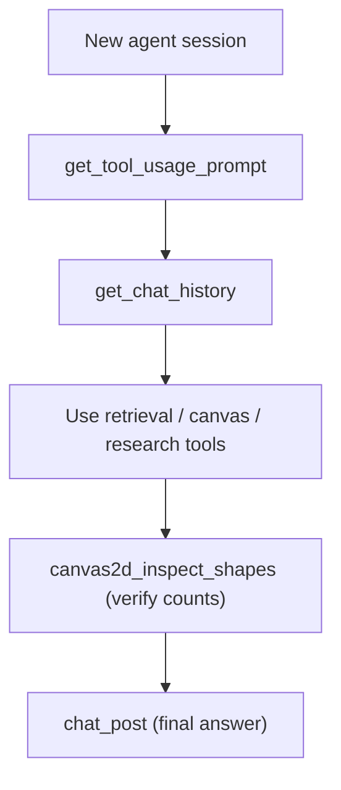

# Agent Operating Guide

`get_tool_usage_prompt` is a read-only, zero-argument WebMCP tool that returns the **agent operating
guide** — a single string (`AGENT_TOOL_GUIDE` in `src/webmcp/agentGuide.ts`) that tells a visiting
agent how to use every other tool correctly. It is the recommended **first call** in any new agent
session.

This page mirrors that guide so humans can read what their agent is told. The live tool remains the
source of truth.



## The Contract in Brief

1. **`chat_post` is the only channel the user sees.** Always post a clear final answer when done.
2. **Every canvas element needs a `type`.** A shape without `type` is silently dropped — the number
   one cause of "only arrows appear, no boxes".
3. **Connectors bind by id.** `arrow` / `line` carry `startId` / `endId` that must exactly equal the
   `id` of an existing node, or the connector will not dock.
4. **Verify before claiming done.** After drawing, call `canvas2d_inspect_shapes` and confirm
   `nodeCount` / `edgeCount` match what was sent.
5. **Never fabricate.** If a search returns `unavailable: true`, report the network failure — do not
   invent results.

## Tool Index

| Tool | Args | What it does |
| :--- | :--- | :--- |
| `get_tool_usage_prompt` | `{}` | Read-only: returns this guide. Call it FIRST in a new session. |
| `get_chat_history` | `{}` | Recent dialogue; user messages are prefixed `user:`. |
| `chat_post` | `{ text }` | Post the answer or status to the chat stream (the only thing the user sees). |
| `canvas2d_draw_shapes` | `{ shapes: [...] }` | Append nodes/connectors to the scene graph. EVERY shape needs `type`. |
| `canvas2d_inspect_shapes` | `{}` | Scene graph + ASCII topology; use it to verify node/edge counts. |
| `canvas2d_modify_shape` | `{ nodeId, newLabel?, fillColor?, strokeColor?, x?, y? }` | In-place edit of one shape. |
| `canvas2d_clear` | `{}` | Reset the scene graph. |
| `search_document` | `{ query }` | BM25 search of the uploaded document; returns top 3 pages. Pass keywords, not sentences. |
| `clean_document` | `{}` | Purge stored document chunks and index. |
| `search_web` | `{ query }` | Live Tavily AI / DuckDuckGo results (carry a `fetchedAt`). |
| `search_research` | `{ query }` | ArXiv papers/preprints (carry a `fetchedAt`). |
| `get_reference_url` | `{}` | Read-only: comma-separated stored reference URLs. |
| `get_user_preferences` | `{}` | Read-only: returns string array of stored user preferences (up to 10 items, max 120 chars each). |
| `calculate` | `{ expression }` | Scientific & decimal math — functions (`sqrt`, `sin`, `log`, …), constants (`pi`, `e`), and Unicode notation (`√`, `²`, `×`). See [Symbol Humanization & Scientific Math](/symbols-and-math). |
| `export_pdf` | `{}` | Build and download the session PDF (canvas snapshot + transcript). |
| `canvas_draw` | `{ command?, commands? }` | LEGACY flat drawing — prefer `canvas2d_draw_shapes`. |
| `draw_diagram` | `{ nodes, edges, title?, clearFirst? }` | LEGACY flat flowchart — prefer `canvas2d_draw_shapes`. |
| `canvas_clear` | `{}` | Clear legacy flat drawings. |

## Canvas Shape Contract

**Node kinds** — `rectangle` | `ellipse` | `diamond` | `polygon` | `path` | `container` | `sticker` | `text`:

```json
{ "type": "rectangle", "id": "gateway", "text": "API Gateway", "subtitle": "[JWT]", "x": 300, "y": 200, "width": 170, "height": 90, "fillColor": "gateway" }
```

- **UML Class**: `{ "type": "rectangle", "id": "user_cls", "x": 100, "y": 100, "width": 200, "height": 130, "compartments": ["UserManager", "+ users: User[]", "+ login(): boolean"] }`
- **Polygon (roofs, triangles, benzene rings)**: `{ "type": "polygon", "id": "roof", "points": [[100, 160], [180, 100], [260, 160]], "fillColor": "terracotta" }`
- **SVG Path (trees, organic shapes, icons)**: `{ "type": "path", "id": "foliage", "x": 100, "y": 100, "d": "M 40 80 C 10 50, 20 20, 60 20 C 80 0, 120 10, 130 30 C 160 20, 180 60, 150 90 Z", "fillColor": "fern" }`
- **Boundary Container**: `{ "type": "container", "id": "backend_cluster", "text": "Backend Services", "x": 250, "y": 150, "width": 420, "height": 280 }`

Use `text` for the visible label. `archetype` is **only** a fill token — never use it (or `label`) in
place of `type` / `text`. Coordinates and dimensions are numbers, not strings.

**Connector kinds** — `arrow` | `line`:

```json
{ "type": "arrow", "id": "e1", "startId": "client", "endId": "gateway", "text": "1. Submit", "strokeDash": [6, 4], "arrowhead": "filled", "bidirectional": false }
```

`startId` / `endId` must exactly match an existing node `id`; the engine docks each connector
edge-to-edge automatically once the ids resolve. For unattached connectors or free vectors, pass `startX`, `startY`, `endX`, `endY`.

**Optional styling:** `fillStyle` (`hachure` default, or `zigzag` / `cross-hatch` / `solid` / `dots`),
`roughness` (0–3, 0 = clean vector), `strokeDash` (e.g. `[6, 4]`), `arrowhead` (`filled` | `open` | `diamond` | `none`), `bidirectional` (boolean), fill tokens (`client`, `gateway`, `db`, `queue`, `logic`) or a
`palette` + token (see [Canvas2D Scene Graph](/canvas-and-pdf)), and `subtitle` for an uppercase
monospace micro-badge.

## Conventions

1. Call this guide tool first in a new session, then check `get_user_preferences` and `get_chat_history` for context and active user rules.
2. Ground answers in `search_document` results when a document is loaded; cite page numbers.
3. Inspect (`canvas2d_inspect_shapes`) before you modify; never clear unless asked.
4. Draw with `canvas2d_draw_shapes` using the 4-tier column flow and under ~15 nodes, then verify
   counts before reporting success.
5. End every task with `chat_post` summarizing what you did and what you drew.
