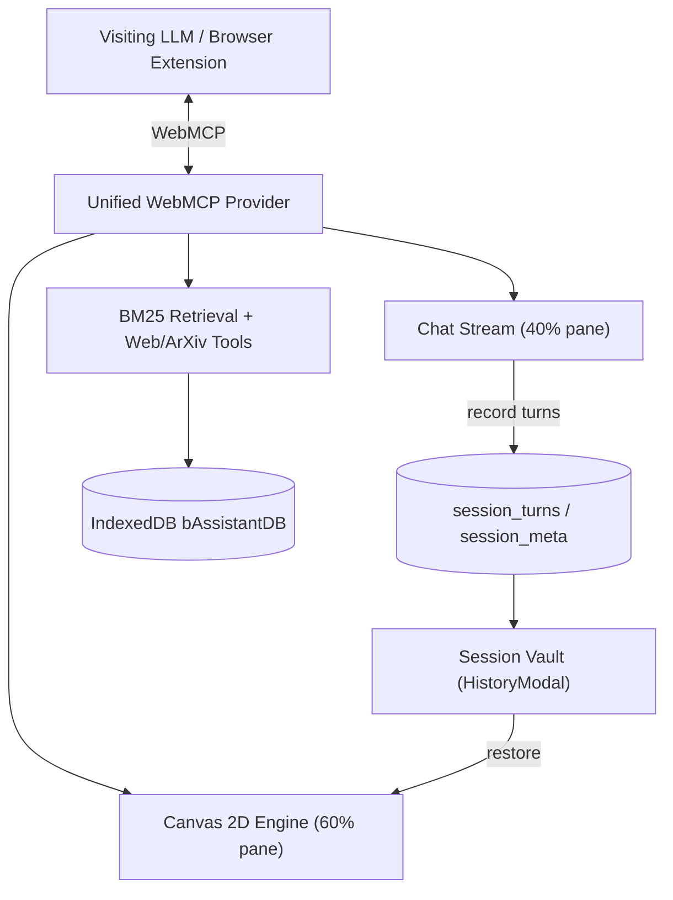

# System Architecture

bAssistant operates entirely within the browser sandbox with zero server dependencies or API secret exposure.

## Core Subsystems

1. **Presentation Layer**: Built with React and styled with Tailwind CSS supporting persistent dark/light cockpit themes via warm paper/ink semantic tokens, an expanded **60% height HTML canvas** alongside a **40% height chat area**, a reference URLs resource manager (capped at 10 items with client reachability probes), a full-screen reader overlay mode, session star highlights in the sidebar, humanized markdown rendering (formatting LLM markdown into styled headers, bullet/numbered lists, code cards, and bold text without raw syntax), **Lora** serif typography optimized for longform reading (15/17/19px steps, line-height 1.75, max-width ~72ch measure), a 2px reading-progress bar, and reactive auto-scrolling to the latest chat turn.
2. **WebMCP Bridge**: Exposes 17 tools across `document.modelContext`, `window.webmcp`, `navigator.modelContext`, and `window.postMessage`, accompanied by `get_tool_usage_prompt` for automated agent guidance.
3. **Lexical Retrieval Engine**: Client-side BM25 index stored in IndexedDB for instant, private text search with query stop-word removal.
4. **2D Rendering Engine**: Dynamic HTML5 canvas drawing shapes, flowcharts, graphs, and annotations from structured LLM tool arguments with perimeter edge docking, plus interactive pan, wheel-zoom, Fit View, and Reset.
5. **Session Vault & Persistence**: Each deliberation turn (user inquiry, agent reply, canvas snapshot, and serialized scene graph) is written to the `session_turns` store, with the active session tracked in `session_meta`. On reload the app rebuilds the chat stream and restores the latest canvas scene graph, and the vault lets users restore, export, or delete past sessions. See [Session Vault & Local Persistence](/sessions-vault).
