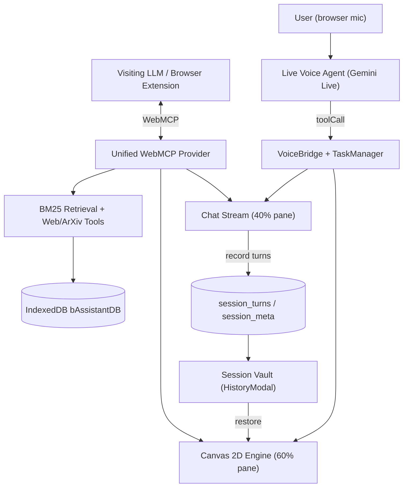

# System Architecture

bAssistant operates entirely within the browser sandbox with zero server dependencies or API secret exposure.

## Core Subsystems

1. **Presentation Layer & Modular Controllers**: Built with React and styled with Tailwind CSS supporting persistent dark/light cockpit themes via warm paper/ink semantic tokens, an expanded **60% height HTML canvas** alongside a **40% height chat area**, a reference URLs resource manager (capped at 10 items with client reachability probes), a user preferences manager (capped at 10 items, max 120 characters each, with interactive modal and counter), a full-screen reader overlay mode, session star highlights in the sidebar, humanized markdown rendering (formatting LLM markdown into styled headers, bullet/numbered lists, code cards, and bold text without raw syntax), **Lora** serif typography optimized for longform reading (15/17/19px steps, line-height 1.75, max-width ~72ch measure), a 2px reading-progress bar, and reactive auto-scrolling to the latest chat turn. State is decoupled through dedicated controller hooks in `src/hooks/` (`useSessionController`, `useDocumentController`, and `useVoiceOrchestrator`), keeping `App.tsx` as a clean composition root.
2. **WebMCP Bridge**: Exposes 18 tools across `document.modelContext`, `window.webmcp`, `navigator.modelContext`, and `window.postMessage`, accompanied by `get_tool_usage_prompt` for automated agent guidance and `get_user_preferences` for reading active user rules.
3. **Lexical Retrieval Engine**: Client-side BM25 index stored in IndexedDB for instant, private text search with query stop-word removal.
4. **2D Rendering Engine**: Dynamic HTML5 canvas drawing shapes, flowcharts, graphs, and annotations from structured LLM tool arguments with perimeter edge docking — rendered with Rough.js hand-drawn sketching (hachure fills, cubic Bézier connectors) and calibrated per theme — plus interactive pan, wheel-zoom, Fit View, and Reset. See [Canvas2D Scene Graph & PDF Export](/canvas-and-pdf).
5. **Session Vault & Persistence**: Each deliberation turn (user inquiry, agent reply, canvas snapshot, and serialized scene graph) is written to the `session_turns` store, with the active session tracked in `session_meta`. On reload the app rebuilds the chat stream and restores the latest canvas scene graph, and the vault lets users restore, export, or delete past sessions. See [Session Vault & Local Persistence](/sessions-vault).
6. **Live Voice Agent (Two-Tier Multi-Provider)**: A full-duplex Gemini Live audio session (Tier 1) delegates heavy visual synthesis to a background subagent (Tier 2) through the `VoiceBridge`, which tracks every dispatch in the `TaskManager`. The Tier 2 subagent engine supports Google Gemini, OpenAI, Mistral AI, Requesty AI, and Ollama Cloud with custom model IDs and in-memory pre-save quick tests. All API keys are isolated and encrypted client-side with AES-GCM-256 before storage. See [Full-Duplex Live Voice Agent](/voice-agent), [Tier 2 Subagent Providers](/subagent-providers), and [Background Task Handling](/background-tasks).
7. **Same-Origin Research Proxy**: Web search (`search_web`, keyless Tavily primary with a DuckDuckGo fallback) and academic search (`search_research`, ArXiv) reach third-party hosts (which lack CORS headers) through a same-origin `/api` layer — a Vite dev proxy plus middleware in development, and Cloudflare Pages Functions in production. See [Research & Math Tools](/research-tools).

The only non-browser code is the thin `/api` proxy described above; everything else — parsing, indexing, rendering, storage, and PDF generation — runs in the browser sandbox.
