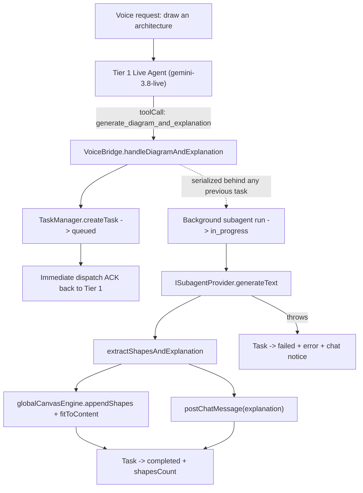
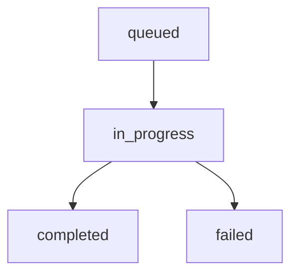

# Background Task Handling

A live voice conversation cannot pause for the multiple seconds a diagram subagent needs to synthesize dense Canvas2D shape JSON and a technical breakdown. So `generate_diagram_and_explanation` is an **asynchronous bridge tool**: it dispatches the Tier 2 subagent in the background and returns to the speaking agent immediately. Everything that happens after that hand-off — tracking, status reporting, failure recovery, and UI feedback — is the job of the **background task layer** in `src/voice/tasks/taskManager.ts` and `src/voice/bridge/voiceBridge.ts`.



See [Full-Duplex Live Voice Agent](/voice-agent) for the two-tier topology that motivates this design.

---

## 1. TaskManager and the Browser Cache

All background tasks are tracked by the `TaskManager` class (`src/voice/tasks/taskManager.ts`), exposed as the module-level singleton `globalTaskManager`. The singleton pattern matches the rest of the app's React-bridging modules (`globalCanvasEngine`, `globalIDBStorage`): the voice bridge and React components share one instance without prop drilling.

```typescript
export interface BackgroundTaskRecord {
  id: string;            // bassistant_task_<timestamp>_<random>
  type: TaskType;        // 'diagram_and_explanation' | 'document_index' | 'pdf_export'
  prompt: string;        // the originating request text
  status: TaskStatus;    // 'queued' | 'in_progress' | 'completed' | 'failed'
  createdAt: number;
  updatedAt: number;
  completedAt?: number;
  shapesCount?: number;
  resultSummary?: string;
  error?: string;
}
```

`TaskType` declares three members, but only `diagram_and_explanation` is created today — `document_index` and `pdf_export` are reserved for future background flows.

- **Cache**: browser `sessionStorage` under the key `bassistant_background_tasks` — no IndexedDB, no server. Task history is per-tab and intentionally lightweight.
- **History cap**: an LRU cap of 20 records; the newest task is always first and the oldest is evicted on `createTask`.
- **API**: `createTask`, `updateTask`, `getTask`, `getLatestTask(type?)`, `getActiveTasks` (queued + in_progress), `getAllTasks`, `clearTasks`, and `subscribe(listener)` for reactive UI.
- Every mutation persists to the cache and notifies subscribers with an immutable snapshot copy — a thrown listener error is logged and never breaks the notify loop.

---

## 2. Task Lifecycle



| State | Meaning |
| --- | --- |
| `queued` | Dispatched, waiting behind a still-running task (see serialization below) |
| `in_progress` | The subagent is generating; the HUD badge is visible |
| `completed` | Shapes rendered (when present) and explanation posted to chat, with `shapesCount` |
| `failed` | Subagent threw; `error` recorded and a `Diagram Generation Notice` posted to chat |

### Stale-Task Recovery on Reload

`sessionStorage` survives a page reload, but a JavaScript background run does not. A task persisted as `queued` or `in_progress` can never finish after a reload — if left alone it would make the HUD badge pulse forever and make `get_background_task_status` report "still working" eternally. To keep the task history honest, `TaskManager.loadFromCache()` demotes every persisted `queued`/`in_progress` record to `failed` with the error `Interrupted by page reload` at construction time, and persists the demotion back to the cache.

---

## 3. Serialized Dispatch

The tool returns instantly, so nothing stops a user from requesting a second diagram while the first is still generating. Two concurrent subagent runs would race on the shared canvas — the first-finishing task's `clearCanvasFirst` could wipe the newer diagram and render the stale one on top.

`VoiceBridge` therefore serializes dispatches: each background run is chained onto the previous one (`previous.then(run)`), so a second request stays `queued` until the first finishes. Runs execute in dispatch order, the newest diagram always lands last on the canvas, and the chain carries a terminal `.catch()` so a failure inside the error handler itself can never surface as an unhandled rejection. `getActiveDiagramTask()` exposes the chain's tail promise for tests and diagnostics.

---

## 4. The `get_background_task_status` Voice Tool

Tier 1 can answer spoken questions like *"is my diagram done yet?"* without guessing. The bridge tool reads the TaskManager directly:

```json
{
  "found": true,
  "taskId": "bassistant_task_1761023400_x7f2a",
  "status": "completed",
  "prompt": "Design an API Gateway with Auth Service",
  "elapsedSeconds": 9,
  "shapesRendered": 3,
  "message": "Task bassistant_task_1761023400_x7f2a completed. 3 architecture elements rendered on the canvas."
}
```

Called with no `taskId` it inspects the **latest** task; with a `taskId` it inspects that specific record. When no tasks exist it returns `found: false` instead of fabricating a status — mirroring the app-wide `SearchOutcome` rule that tools never invent data.

---

## 5. Reactive HUD Badge

`VoiceLiveController` (the Voice HUD in the ChatArea toolbar) subscribes to `globalTaskManager` on mount and renders an animated amber badge — `⚡ Drawing Architecture...` — whenever any task is `queued` or `in_progress`, with the originating prompt as the tooltip. The badge disappears the moment the task settles; combined with stale-task demotion, it can never get stuck on after a reload. Like all app motion, the pulse respects the global `prefers-reduced-motion` kill-switch in `src/index.css`.

---

## 6. Testing

The task layer is covered by hermetic Vitest suites (no real browser storage, no network):

- `src/tests/taskManager.test.ts` — ID format, cache persistence, full lifecycle transitions, subscriber notifications, the 20-record cap, and stale `in_progress` demotion from a seeded cache.
- `src/tests/voiceBridge.test.ts` — dispatch-ACK contract, background success and failure paths, `get_background_task_status` results, and the serialized-dispatch ordering test (a deferred first call proves the second task stays `queued` and the canvas ends with the newest diagram).
- `src/tests/voiceLiveController.test.tsx` — badge appears for an active task and clears on completion.
