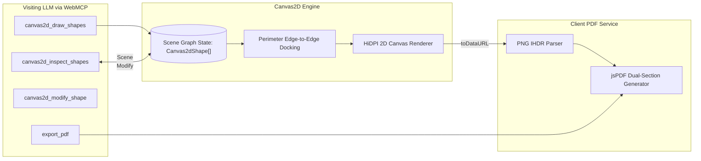

# Canvas2D Scene Graph & PDF Export

bAssistant incorporates a structured 2D scene-graph canvas engine alongside client-side PDF export, allowing visiting LLMs to build, inspect, mutate, and export diagrams programmatically.

## Architecture

## Scene Graph & Supported Shapes

Instead of fire-and-forget pixel drawing commands, the canvas maintains a persistent scene graph (`Canvas2dShape[]`):

1. **`rectangle`**: Standard service or component block with rounded corners (`r = 10`) and soft shadows.
2. **`ellipse`**: Data store or persistence node.
3. **`diamond`**: Decision logic or routing gate.
4. **`text`**: Standalone typographic annotation.
5. **`sticker`**: Callout note with `stickerColor` (`yellow`, `mint`, `rose`) and optional emoji icon.
6. **`arrow` / `line`**: Connectors that bind to node boundaries (`startId`, `endId`) and stay dynamically attached when nodes move.
7. **`freedraw`**: Freehand stroke stored as a point array (`points`), rendered as a polyline rather than pixels.

## Artistic Rendering (Rough.js)

Shape interiors are rendered with [Rough.js](https://roughjs.com/) (`roughjs ^4.6.6`, MIT) for a
hand-drawn editorial look rather than rigid vector polygons:

- **Hachure fills** are the default when a fill color is present (`fillStyle: 'hachure'`, `hachureAngle: -41`, `hachureGap: 6`); `solid`, `zigzag`, `cross-hatch`, and `dots` are opt-in per shape.
- **`fillWeight`** is set to `max(strokeWidth, 1)` so hatch strokes stay legible against the dark backdrop instead of fading out.
- **Fluid connectors**: arrows and lines render as orientation-aware cubic Bézier splines (`ctx.bezierCurveTo`) with tangent-aligned arrowheads; set `curved: false` for a clean straight edge.
- **Palettes**: a named `palette` (`risograph`, `editorial`, `botanical`, `cyberpunk`) resolves its tokens, and archetype tokens (`client`, `gateway`, `db`, `queue`, `logic`) are resolved by `resolveHarmonizedFill()`; harsh primary hex inputs (`#ff0000`, `#0000ff`, …) are softened into print-grade tones.
- Rough.js is used when `roughness > 0`; `roughness: 0` falls back to the plain rounded-rect / ellipse / polygon path.

## Geometry Normalization & Total Type Dispatch

Two invariants keep agent-authored shapes from silently disappearing:

1. **Numeric coercion.** `sanitizeCanvas2dShapes()` coerces `x`, `y`, `width`, `height`, `strokeWidth`,
   `fontSize`, `roughness`, `bowing`, `hachureAngle`, `hachureGap`, and connector coordinates
   (`startX/startY/endX/endY`) to finite numbers. This matters because Rough.js computes rectangle
   corners as `x + width` — a string dimension like `"160"` concatenates to `"100160"` and flings the
   shape off-canvas. Non-finite values are dropped so defaults apply.
2. **Type aliases + total dispatch.** Aliases are normalized (`rect`/`box`/`card`/`container`/`node`/`square`
   → `rectangle`; `circle`/`oval`/`database`/`db` → `ellipse`; `note`/`sticky` → `sticker`; …). The
   `renderShape` switch enumerates every type and ends in a `default` that renders unknown types as a
   rectangle with a `console.warn`, so a shape is never dropped without a trace.

## Fill Transparency & Theme Calibration

Hatch/fill transparency is now uniform across themes, and the artwork stays legible against each backdrop:

- **Forced fill alpha (80% transparent).** `renderShape` rewrites every fill to `rgba(r, g, b, 0.2)`
  (`DARK_FILL_ALPHA = 0.2`) via `normalizeRgba()` — in **both** light and dark mode — so the angled
  hachure strips are always see-through. `normalizeRgba()` parses hex, `rgb()`/`rgba()`, and named
  colors; previously only integer `rgba()` strings were rescaled, so hex fills rendered fully opaque.
- **Elevated substrate pills.** Connector labels use a slate card (`rgba(15,23,42,0.92)` fill,
  `rgba(148,163,184,0.35)` keyline) in dark mode and a warm off-white card (`rgba(255,253,247,0.96)`,
  `#cbd5e1` keyline) in light mode — no milky semi-transparent-white hazing on black.
- **Single source of truth for theme.** `renderShape`/`drawLabel` trust the passed `theme` argument;
  `CanvasEngine.syncThemeFromDom()` is the only place that reads the `<html class="dark">` DOM state.
  This stops dark styling from leaking into light renders (and into offscreen snapshot captures).

## Perimeter Edge-to-Edge Docking

Connectors compute the dominant vector between shape centers and dock to the facing perimeter boundaries:
- Never passes through node center text.
- Connectors stay anchored automatically without manual coordinate calculation.
- Edge labels render with protective backdrop pills (`rgba(255,253,247,0.96)` in light, `rgba(15,23,42,0.92)` in dark).

## Viewport Matrix & Visual Enhancements

The Canvas2D engine features interactive viewport management and depth rendering:
- **`fitToContent` Auto-Centering:** Evaluates the bounding box of all shapes and centers/scales the view transform (`scale`, `offsetX`, `offsetY`) so off-viewport coordinates never clip; the scale is clamped to `[0.2, 1.5]`.
- **Interactive Pan & Smooth Wheel Zoom:** Allows users to drag-to-pan across the canvas plane and zoom with mouse wheel (`zoomAtPoint`, factor 1.1 in / 0.9 out, scale clamped `[0.2, 4]`), keeping the cursor focus pinned. The `Fit View` and `Reset` toolbar buttons map to `fitToContent()` and `resetView()`.
- **Tight-Crop Snapshot Export:** `getSnapshotDataUrl()` computes the content bounds of all shapes, renders them to an offscreen canvas with a 40px padding (nodes first, then docked connectors), and returns a cropped PNG data URL — used for canvas snapshots in PDF reports and persisted session turns.
- **2.5D Drop Shadows:** Nodes render with ambient elevation shadows (`shadowOffsetY: 4`, `shadowBlur: 12`), cleared before stroking borders for crisp lines.
- **Theme-Aware Contrast:** `applyThemeAlpha` scales fill alpha up in light mode so soft tones stay visible on warm paper; `resolveThemeTextColor` normalizes white/off-white/black/washed-out colors to the universal amber `#d97706` (`MEDIUM_DARK_YELLOW`), while genuine custom accent colors pass through — giving labels equal, readable contrast in both themes. These stateless color, geometry, and render-pipeline helpers live in `src/lib/canvasHelper.ts` (with `parseColorLuminance`, `isLightColor`, `isDarkColor`), consumed by the `CanvasEngine` class in `src/lib/canvasEngine.ts`.
- **Live DOM Theme Synchronization:** A `MutationObserver` on `document.documentElement` dynamically tracks theme class toggles in real time via `getTheme()`, triggering automatic redraws without delay or state mismatch.

## Translucent Color Palette

Fill colors are authored as translucent `rgba()` (or archetype/palette tokens resolved by
`resolveHarmonizedFill`), then `renderShape` forces the strip alpha to `0.2` (`DARK_FILL_ALPHA = 0.2` —
80% transparent) in **both** themes. Strokes adapt via `resolveThemeStrokeColor()` (default `#94a3b8` in
dark, `#334155` in light), and every label resolves to the universal high-contrast amber `#d97706`
(`MEDIUM_DARK_YELLOW`) in both themes.

| Role | Authored fill | Archetype token |
| :--- | :--- | :--- |
| **Client / Ingress** | `rgba(99,102,241,0.22)` | `client` |
| **Server / Gateway** | `rgba(16,185,129,0.20)` | `gateway` |
| **Database / Storage** | `rgba(168,85,247,0.22)` | `db` |
| **Cache / Queue** | `rgba(251,146,60,0.22)` | `queue` |
| **Decision / Logic** | `rgba(250,204,21,0.20)` | `logic` |

A **Risograph / editorial** palette is also available via the `palette` field plus a token name. Four
palettes are defined (`EDITORIAL_PALETTES` in `src/lib/canvasHelper.ts`):

| Palette | Tokens |
| :--- | :--- |
| `risograph` | `terracotta` `rgba(224,109,83,0.22)`, `cobalt` `rgba(59,102,207,0.22)`, `sage` `rgba(78,154,126,0.22)`, `sunflower` `rgba(229,169,59,0.22)`, `plum` `rgba(124,74,115,0.22)` |
| `editorial` | `olive` `rgba(85,107,47,0.22)`, `ochre` `rgba(204,119,34,0.22)`, `slate` `rgba(47,53,66,0.22)`, `rose` `rgba(214,109,117,0.22)` |
| `botanical` | `fern` `rgba(74,124,89,0.22)`, `moss` `rgba(141,153,111,0.22)`, `eucalyptus` `rgba(92,131,116,0.22)`, `bark` `rgba(125,90,80,0.22)` |
| `cyberpunk` | `cyan` `rgba(6,182,212,0.24)`, `lavender` `rgba(168,85,247,0.24)`, `amber` `rgba(245,158,11,0.24)`, `carbon` `rgba(30,41,59,0.28)` |

The tokens that are also archetype keys (`terracotta`, `cobalt`, `sage`, `sunflower`, `plum`, `olive`,
`ochre`) can be passed directly as a `fillColor` without setting `palette`; the remaining tokens
(`fern`, `moss`, `cyan`, `carbon`, …) require the matching `palette` name.

## Client-Side PDF Generation & Active Session Persistence

Users and visiting LLMs can export a full session report:
1. **Active Session Persistence**: Active deliberation turns are persisted to IndexedDB (`session_turns` and `session_meta`). On page reloads, dialogue history and canvas scene graphs are automatically restored. See [Session Vault & Local Persistence](/sessions-vault).
2. **Sequential Turn-by-Turn Reporting**: Compiles turns chronologically with turn badges (`TURN X [HH:MM]`), optional user inquiries, per-turn canvas snapshots, and AI responses.
3. **Header with Top-Left Logo**: Every exported PDF features the bAssistant branding logo rendered at top-left (`10mm x 10mm`) alongside title `"bAssistant Deliberation Session"`, session ID, and timestamp. The image is inlined as `BASSISTANT_LIGHT_BASE64` from `src/lib/logoBase64.ts`, so no network fetch is needed at export time.
4. **Blank Content Validation**: Checks that the session has either active canvas drawings or chat dialogue. If both are blank, the export is prevented and a validation modal alerts the user.
5. **Markdown Humanization**: Automatically parses LLM Markdown formatting into publication-ready typography:
   - Headings (H1 to H6: `#` to `######`) rendered in bold Helvetica with proportional sizing (H1: 12.5pt, H2: 11pt, H3: 10pt, H4–H6: 9.5pt).
   - Bulleted (`• `) and numbered lists (`1. `) cleanly indented.
   - Fenced code blocks styled in Courier monospace with a light-slate background tint.
   - Blockquotes (`> `) rendered in italic with vertical boundary line accents.
   - Strips raw markdown tokens (`**`, `*`, `` ` ``, `[label](url)`) into clean text.
6. **Multilingual Indic Script Support (Bengali & Hindi)**: Native browser font-shaping ensures Bengali (বাংলা) and Hindi (हिन्दी) complex conjuncts and matras render with 100% typographic fidelity.
7. **Multipage Pagination & Buffer**: Deliberation streams automatically calculate cursor height with a 10mm reserved buffer, triggering `doc.addPage()` seamlessly for long transcripts without clipping.
8. **Mandatory Disclaimer Footer**: Every generated page stamps the centered disclaimer:
   > `AI generated analysis, verify before applying.`
   alongside a right-aligned page counter (`Page X of Y`).
9. **100% In-Browser**: Built via `jspdf` with zero backend server dependencies.
