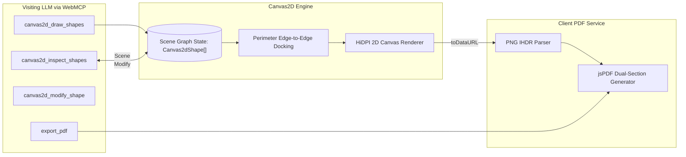

# Canvas2D Scene Graph & PDF Export

bAssistant incorporates a structured 2D scene-graph canvas engine alongside client-side PDF export, allowing visiting LLMs to build, inspect, mutate, and export diagrams programmatically.

## Architecture

## Scene Graph & Supported Shapes

Instead of fire-and-forget pixel drawing commands, the canvas maintains a persistent scene graph (`Canvas2dShape[]`):

1. **`rectangle`**: Standard service or component block with rounded corners (`r = 10`) and soft shadows.
2. **`ellipse`**: Data store or persistence node.
3. **`diamond`**: Decision logic or routing gate.
4. **`text`**: Standalone typographic annotation.
5. **`sticker`**: Callout note with `stickerColor` (`yellow`, `mint`, `rose`) and optional emoji icon.
6. **`arrow` / `line`**: Connectors that bind to node boundaries (`startId`, `endId`) and stay dynamically attached when nodes move.

## Perimeter Edge-to-Edge Docking

Connectors compute the dominant vector between shape centers and dock to the facing perimeter boundaries:
- Never passes through node center text.
- Connectors stay anchored automatically without manual coordinate calculation.
- Edge labels render with protective backdrop pills (`rgba(255,255,255,0.95)` in light, `rgba(24,24,27,0.95)` in dark).

## Soft-Translucent Color Palette

| Role | Fill Color (`rgba`) | Stroke Color | Text Color |
| :--- | :--- | :--- | :--- |
| **Client / Ingress** | `rgba(99,102,241,0.18)` | `#818cf8` | `#e0e7ff` |
| **Server / Gateway** | `rgba(16,185,129,0.16)` | `#34d399` | `#d1fae5` |
| **Database / Storage** | `rgba(168,85,247,0.18)` | `#c084fc` | `#f3e8ff` |
| **Cache / Queue** | `rgba(251,146,60,0.18)` | `#fb923c` | `#ffedd5` |
| **Decision / Logic** | `rgba(250,204,21,0.16)` | `#fbbf24` | `#fef9c3` |

## Client-Side PDF Generation

Users and visiting LLMs can export a full session report:
1. **Blank Content Validation**: Checks that the session has either active canvas drawings or chat dialogue. If both are blank, the export is prevented and a validation modal alerts the user.
2. **Markdown Humanization**: Automatically parses LLM Markdown formatting into publication-ready typography:
   - Headings (`#`, `##`, `###`) rendered in bold Helvetica with proportional sizing.
   - Bulleted (`• `) and numbered lists (`1. `) cleanly indented.
   - Fenced code blocks styled in Courier monospace with a light-slate background tint.
   - Blockquotes (`> `) rendered in italic with vertical boundary line accents.
   - Strips raw markdown tokens (`**`, `*`, `` ` ``, `[label](url)`) into clean text.
3. **Canvas Snapshot**: Fitted uniformly at the top of Page 1.
4. **Dialogue Transcripts**: Formatted beneath with sender badges, timestamps, and multi-page overflow pagination.
5. **100% In-Browser**: Built via `jspdf` with zero backend server dependencies.
