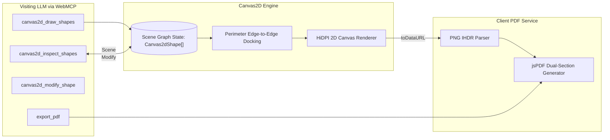

# Canvas2D Scene Graph & PDF Export

bAssistant incorporates a structured 2D scene-graph canvas engine alongside client-side PDF export, allowing visiting LLMs to build, inspect, mutate, and export diagrams programmatically.

## Architecture

## Scene Graph & Supported Shapes

Instead of fire-and-forget pixel drawing commands, the canvas maintains a persistent scene graph (`Canvas2dShape[]`):

1. **`rectangle`**: Standard service or component block with rounded corners (`r = 10`) and soft shadows.
2. **`ellipse`**: Data store or persistence node.
3. **`diamond`**: Decision logic or routing gate.
4. **`text`**: Standalone typographic annotation.
5. **`sticker`**: Callout note with `stickerColor` (`yellow`, `mint`, `rose`) and optional emoji icon.
6. **`arrow` / `line`**: Connectors that bind to node boundaries (`startId`, `endId`) and stay dynamically attached when nodes move.
7. **`freedraw`**: Freehand stroke stored as a point array (`points`), rendered as a polyline rather than pixels.

## Perimeter Edge-to-Edge Docking

Connectors compute the dominant vector between shape centers and dock to the facing perimeter boundaries:
- Never passes through node center text.
- Connectors stay anchored automatically without manual coordinate calculation.
- Edge labels render with protective backdrop pills (`rgba(255,255,255,0.95)` in light, `rgba(24,24,27,0.95)` in dark).

## Viewport Matrix & Visual Enhancements

The Canvas2D engine features interactive viewport management and depth rendering:
- **`fitToContent` Auto-Centering:** Evaluates the bounding box of all shapes and centers/scales the view transform (`scale`, `offsetX`, `offsetY`) so off-viewport coordinates never clip; the scale is clamped to `[0.2, 1.5]`.
- **Interactive Pan & Smooth Wheel Zoom:** Allows users to drag-to-pan across the canvas plane and zoom with mouse wheel (`zoomAtPoint`, factor 1.1 in / 0.9 out, scale clamped `[0.2, 4]`), keeping the cursor focus pinned. The `Fit View` and `Reset` toolbar buttons map to `fitToContent()` and `resetView()`.
- **Tight-Crop Snapshot Export:** `getSnapshotDataUrl()` computes the content bounds of all shapes, renders them to an offscreen canvas with a 40px padding (nodes first, then docked connectors), and returns a cropped PNG data URL — used for canvas snapshots in PDF reports and persisted session turns.
- **2.5D Drop Shadows:** Nodes render with ambient elevation shadows (`shadowOffsetY: 4`, `shadowBlur: 12`), cleared before stroking borders for crisp lines.
- **Light Theme Contrast Boost:** Scaled fill alpha (`applyThemeAlpha`) prevents soft translucent colors from appearing washed out on light paper backgrounds.

## Soft-Translucent Color Palette

| Role | Fill Color (`rgba`) | Stroke Color | Text Color |
| :--- | :--- | :--- | :--- |
| **Client / Ingress** | `rgba(99,102,241,0.18)` | `#818cf8` | `#e0e7ff` |
| **Server / Gateway** | `rgba(16,185,129,0.16)` | `#34d399` | `#d1fae5` |
| **Database / Storage** | `rgba(168,85,247,0.18)` | `#c084fc` | `#f3e8ff` |
| **Cache / Queue** | `rgba(251,146,60,0.18)` | `#fb923c` | `#ffedd5` |
| **Decision / Logic** | `rgba(250,204,21,0.16)` | `#fbbf24` | `#fef9c3` |

## Client-Side PDF Generation & Active Session Persistence

Users and visiting LLMs can export a full session report:
1. **Active Session Persistence**: Active deliberation turns are persisted to IndexedDB (`session_turns` and `session_meta`). On page reloads, dialogue history and canvas scene graphs are automatically restored. See [Session Vault & Local Persistence](/sessions-vault).
2. **Sequential Turn-by-Turn Reporting**: Compiles turns chronologically with turn badges (`TURN X [HH:MM]`), optional user inquiries, per-turn canvas snapshots, and AI responses.
3. **Header with Top-Left Logo**: Every exported PDF features the bAssistant branding logo rendered at top-left (`10mm x 10mm`) alongside title `"bAssistant Deliberation Session"`, session ID, and timestamp. The image is inlined as `BASSISTANT_LIGHT_BASE64` from `src/lib/logoBase64.ts`, so no network fetch is needed at export time.
4. **Blank Content Validation**: Checks that the session has either active canvas drawings or chat dialogue. If both are blank, the export is prevented and a validation modal alerts the user.
5. **Markdown Humanization**: Automatically parses LLM Markdown formatting into publication-ready typography:
   - Headings (`#`, `##`, `###`) rendered in bold Helvetica with proportional sizing.
   - Bulleted (`• `) and numbered lists (`1. `) cleanly indented.
   - Fenced code blocks styled in Courier monospace with a light-slate background tint.
   - Blockquotes (`> `) rendered in italic with vertical boundary line accents.
   - Strips raw markdown tokens (`**`, `*`, `` ` ``, `[label](url)`) into clean text.
6. **Multilingual Indic Script Support (Bengali & Hindi)**: Native browser font-shaping ensures Bengali (বাংলা) and Hindi (हिन्दी) complex conjuncts and matras render with 100% typographic fidelity.
7. **Multipage Pagination & Buffer**: Deliberation streams automatically calculate cursor height with a 10mm reserved buffer, triggering `doc.addPage()` seamlessly for long transcripts without clipping.
8. **Mandatory Disclaimer Footer**: Every generated page stamps the centered disclaimer:
   > `AI generated analysis, verify before applying.`
   alongside a right-aligned page counter (`Page X of Y`).
9. **100% In-Browser**: Built via `jspdf` with zero backend server dependencies.
