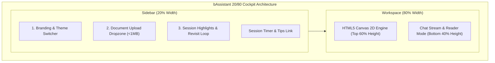

# Cockpit UI & User Experience

bAssistant is structured as a dedicated business analyst workstation that runs entirely in the browser. Designed for extended sessions, its interface pairs visual system modeling with conversation while eliminating distraction and eye strain.

## The 20/80 Cockpit Partition

The viewport is divided horizontally into a left sidebar and a primary workspace:

### 1. Left Sidebar (20% Width)
The sidebar serves as the control and context panel:
- **Branding & Theme Toggle**: Displays the product title and provides instant light/dark mode switching.
- **Document Dropzone**: Ingests `.pdf`, `.docx`, or `.doc` files strictly under 1MB. Displays parsing status badges (`Parsing...`, `Indexed`, or error modal) with clear file-type validation.
- **Session Highlights**: Starred messages from the conversation collect here automatically. Clicking any highlight smoothly scrolls the chat stream directly to that turn.
- **Session Duration & Tips**: Displays live session time (`messages · highlights · minutes`) without countdown pressure, along with a link to re-open the onboarding walkthrough.

### 2. Primary Workspace (80% Width)
The workspace divides vertically to optimize visual and textual cognitive workflows:
- **Top 60% — HTML5 Canvas**: Dedicated visual modeling pane where visiting LLMs render architecture components, decision diamonds, containers, and perimeter-docked arrows.
- **Bottom 40% — Conversation Stream**: Reading-optimized chat pane formatted with **Lora** typography (72-character line measure, 1.75 line-height) and humanized markdown rendering.

---

## Long-Dwell UI & Ergonomics

To support deep analytical work, bAssistant incorporates dedicated dwell-time ergonomics:

### Warm Semantic Token System
Rather than high-glare white or cold blue-black dark surfaces, bAssistant uses low-strain semantic tokens defined in `src/index.css`:
- **Light Theme**: Warm paper surface (`#fffdf7`) with navy ink text (`#14213d`).
- **Dark Theme**: Warm ink surfaces (`#191714` family) with soft parchment text (`#e6e1d8`).
- **Accent Roles**: Distinct semantic roles for client ingress (indigo), gateways (emerald), databases (purple), and decision logic (amber).

### Zen Reader Mode (⤢)
When inspecting long analytical responses or technical breakdowns, users can click the expand icon (`⤢`) to open the chat stream as a full-screen distraction-free reader overlay:
- Suppresses surrounding workspace chrome.
- Preserves full input capability, message copying, and typography controls.
- Instantly dismissed via the `Escape` key or close button (`✕`).

### Appearance & Font Controls
Readers can tailor the chat stream to their visual comfort using the `A-` / `A+` controls:
- **Available Steps**: 15px, 17px (default), and 19px.
- **Persistence**: Selections are saved automatically in `localStorage['b_font_size']`.

### Reading Progress Indicator
A subtle 2px violet progress bar mounted above the conversation stream dynamically indicates scroll position through lengthy multi-turn discussions, providing orientation without intrusive metrics.

### Calm Feedback & Micro-Interactions
- **Thinking Pulse**: A gentle breathing indicator signals when an agent is processing a turn.
- **Entrance Fades**: Smooth 0.18s message transitions avoid jarring visual pop-in.
- **First-Load Onboarding**: A 6-step modal introduces key workflows (document upload, canvas drawing, WebMCP agent connectivity, and PDF export) on the first visit.
- **Motion Accessibility**: Full support for `@media (prefers-reduced-motion: reduce)` automatically disables animations for users with vestibular sensitivities.
