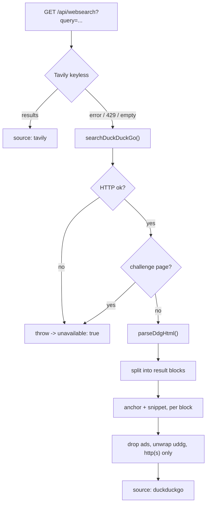

# DuckDuckGo Fallback & Parser Nuances

`search_web` is served by the same-origin `/api/websearch` layer. Keyless **Tavily AI** is tried
first; when it errors, rate-limits (HTTP 429), or returns nothing, the proxy falls back to scraping
**DuckDuckGo HTML** and parsing the results with `src/lib/ddgSearch.ts`. This page documents the
non-obvious details of that fallback — the things that decide whether a snippet lands on the right
result and whether a blocked request is reported honestly.

## Why HTML scraping (and why it's the fallback, not the primary)

DuckDuckGo's documented `api.duckduckgo.com` Instant-Answer endpoint returns encyclopedic abstracts,
not ranked web results — it is unusable as a general web index. There is no official, keyless,
JSON API for DDG web results, so the only zero-cost option is to scrape the HTML results page. That
brings three consequences that shape the whole design:

- **No contract.** The markup is not an API; it can change without notice, so the parser is written defensively and covered by tests.
- **Aggressive rate-limiting.** Datacenter egress IPs (Cloudflare Functions) are challenged frequently.
- **Challenge pages return HTTP 200.** A bot-wall is a *successful* HTTP response, which is exactly the case that silently corrupts "honest results".

Because of this, DDG is the fallback — Tavily stays primary.

## Where it runs

The scrape never happens in the browser. It runs in the same-origin `/api` layer:

- **Development:** the `dev-api-endpoints` middleware in `vite.config.ts`.
- **Production:** the Cloudflare Pages Function `functions/api/websearch.ts`.

The browser only ever calls the relative `/api/websearch?query=...` path, so there is no CORS
dependency on DuckDuckGo and no third-party host is contacted by client code.



## The request

A single GET to `https://html.duckduckgo.com/html/?q={encoded-query}` with browser-like headers:

| Header | Value | Why |
| :--- | :--- | :--- |
| `User-Agent` | a current desktop Chrome UA | Present as a normal browser; the default fetch UA is challenged. |
| `Accept` | `text/html` | Ask for the HTML results page, not JSON. |
| `Referer` | `https://html.duckduckgo.com/` | Same-origin referer, as a real navigation would send. |
| `Accept-Language` | `en-US,en;q=0.9` | Reduces anomaly-page triggers. |

## What the raw HTML looks like

Each organic result is a block whose container class contains `result` (fully:
`result results_links results_links_deep web-result`). Inside it are two anchors:

```html
<div class="result results_links results_links_deep web-result">
  <a rel="nofollow" class="result__a" href="//duckduckgo.com/l/?uddg=https%3A%2F%2Fexample.com%2Fpage&rut=...">
    Example <b>Page</b>
  </a>
  <a class="result__snippet" href="//duckduckgo.com/l/?uddg=...">A short description &amp; more.</a>
</div>
```

Sponsored results use a class containing `result--ad` and their href is a
`//duckduckgo.com/y.js?...` redirect rather than a `uddg` link.

## The parse pipeline

`parseDdgHtml(html, limit = 5)` is a pure function — no network — so it can be tested directly:

1. **Split into result blocks** on the result container class.
2. **Read the anchor and the snippet from the same block** (`result__a` and `result__snippet`).
3. **Skip ad/redirect anchors** whose href is a `duckduckgo.com/y.js` link.
4. **Unwrap the redirect and validate** the destination is `http(s)`; drop anything else.
5. **Strip tags and decode entities** to produce plain title/snippet text.

## The nuances

**Block-scoped pairing, not positional.** The subtle bug to avoid is collecting every
`result__snippet` on the page and then pairing them to results by array index. The moment an anchor
is skipped (empty href) or the snippet/results counts differ (an ad, a "related searches" block, a
stray snippet), every snippet after that point is shifted onto the wrong result. Reading the snippet
from **inside the same block** as its title makes that class of error impossible.

**Redirect unwrapping.** DuckDuckGo links are not the target — they are
`//duckduckgo.com/l/?uddg=<percent-encoded-target>&rut=...`. The parser decodes the `uddg` parameter
to recover the real URL; protocol-relative links (`//host/...`) are upgraded to `https:`. The result
URL is what an agent sees and may cite, so the guard matters.

**Only `http(s)` survives.** After unwrapping, any candidate that is not `http:`/`https:` is
dropped. This prevents a malformed or hostile `uddg` from surfacing a `javascript:` or `data:` URL to
the model.

**Ad/redirect filtering.** `y.js` links are sponsored placements and are excluded rather than
returned as if they were organic results.

**Entity and tag handling.** Titles carry `<b>` highlight tags and both fields carry HTML entities.
`clean()` strips tags first, then decodes **named and numeric** entities (`&amp;`, `&#39;`, `&#x2F;`),
and collapses whitespace — so snippets arrive as plain text, never raw markup.

**Bot-walls look like success.** A challenge page is HTTP **200** with no result blocks. The parser
detects it (no result blocks plus markers such as `anomaly`, "Unfortunately, bots use
DuckDuckGo too", `challenge-platform`) and `searchDuckDuckGo` **throws** — so the proxy reports
`unavailable: true` rather than an empty-but-successful result.

## Failure behavior

| Condition | `searchDuckDuckGo` | `/api/websearch` response |
| :--- | :--- | :--- |
| Blank query | returns `[]`, no fetch | `200 { results: [], source: 'duckduckgo' }` |
| Non-OK status (e.g. 429) | throws | `502 { results: [], unavailable: true, error }` |
| Challenge / bot-wall page | throws | `502 { results: [], unavailable: true, error }` |
| Genuinely empty results page | returns `[]` | `200 { results: [], source: 'duckduckgo' }` |
| Ads-only page | returns `[]` (filtered) | `200 { results: [], source: 'duckduckgo' }` |

The distinction between "empty" and "blocked" is deliberate: an empty success and a masked bot-wall
must not be reported the same way to a visiting agent.

## Result contract

Each parsed result is `{ title, snippet, url }`. The proxy annotates the payload with
`source: 'duckduckgo'` and an ISO `fetchedAt` timestamp, matching the Tavily shape so consumers do
not need to branch on provider.

Notable differences from the primary path: DDG results carry **no relevance `score`** (Tavily does),
there is **no pagination** (top-`limit`, default 5), and results reflect DuckDuckGo's index at
request time — there is no caching layer.

## Testing

The parser and its failure path are covered by a hermetic suite, `src/tests/ddgSearch.test.ts`
(no network): result parsing, the snippet-misalignment regression, entity decoding, ad filtering,
non-`http(s)` URL dropping, the result limit, the blank-query no-fetch path, the non-OK throw, and
the challenge-page throw.

See also [Research & Math Tools](/research-tools) for the `/api` layer and
[Keyless Tavily Search & Fallback](/tavily-search) for the primary provider.
