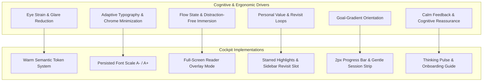

# UI Dwell-Time Research

Business analysis, system modeling, and document investigation are cognitively intensive tasks. When users inspect complex architectures, ingest technical specifications, and dialogue with an AI assistant, sessions often span hours.

bAssistant incorporates six evidence-backed UX mechanisms designed to minimize cognitive friction, eliminate eye strain, and sustain user immersion without distraction.

## The Six Core Mechanisms

### 1. Warm Surfaces Reduce Eye Fatigue
Standard high-contrast dark modes with cold, blue-black surfaces (such as `slate-950` or `#000000`) induce digital eye strain during prolonged reading. Research demonstrates that warm, low-glare palettes significantly alleviate visual fatigue.

- **Light Mode**: Warm paper background (`#fffdf7`) paired with a deep navy ink (`#14213d`).
- **Dark Mode**: Warm ink surfaces (`#191714` family), eschewing cold blue-black undertones.
- **Token System**: Implemented via semantic CSS variables (`--paper`, `--panel`, `--card`, `--ink`, `--line`, accent roles) in `src/index.css`.

### 2. Appearance Controls & Minimal Chrome
Inspired by dedicated reading platforms such as Readwise Reader, power users remain engaged when typography adapts to their visual needs.

- **Adjustable Type Scale**: A- / A+ font scale steps (15px, 17px, 19px) applied to the central Lora reading column.
- **Persistence**: User preferences are automatically saved in `localStorage['b_font_size']`.
- **Minimal Framing**: Surrounding headers and decorative chrome are restrained to preserve content hierarchy.

### 3. Zen / Full-Screen Maximize Preserves Flow
Neuroscientific research on flow states highlights that removing surrounding action chrome sustains concentration. When drafting or analyzing dense answers, writers and analysts benefit from distraction-free modes.

- **Expand Mode (⤢)**: Chat expands into an edge-to-edge reading popup.
- **Frictionless Exit**: Immediate escape via `Escape` key or close button (`✕`), returning seamlessly to the cockpit.
- **Consistent Capabilities**: Stream input, message copying, and font scaling remain fully available in reader mode.

### 4. Highlights Create Personal Value & Revisit Loops
Educational psychology and social annotation platforms (such as Hypothesis and Readwise) show that highlighting content dramatically increases comprehension and critical retention.

- **Per-Message Star (☆/★)**: Users can star pivotal findings or LLM diagram descriptions.
- **Session Highlights**: Starred messages collect in Section 3 of the sidebar (`BlankSlot.tsx`).
- **Interactive Revisit Loop**: Clicking any saved highlight in the sidebar smoothly scrolls the chat viewport directly to that turn.

### 5. Goal-Gradient Progress Indicators
Slim progress indicators leverage the goal-gradient effect from behavioral economics, orienting readers and communicating momentum without stressful countdown pressure.

- **Scroll-Position Progress Bar**: A 2px violet reading-progress indicator mounted above the conversation stream tracks position through the dialogue.
- **Session Investment Strip**: A restrained status bar displaying `messages · highlights · session duration` in the sidebar provides quiet orientation.

### 6. Calm, Alive Feedback & Restrained Motion
Micro-interactions modulate user time perception and emotional comfort during asynchronous AI tasks. However, aggressive animations cause distraction. Following calm-design principles:

- **Thinking Pulse**: An unobtrusive breathing animation indicates when an agent is processing a turn.
- **Entrance Transitions**: Short 0.18s message entrance fades introduce new thoughts gently.
- **First-Load Onboarding**: `WelcomeModal.tsx` provides a 7-step walkthrough for newcomers, re-openable at any time from the sidebar.
- **Accessibility & Motion Kill-Switch**: Full support for `prefers-reduced-motion` ensures that all transitions are suppressed when requested by the OS.

---

## Architectural Mapping

| Research Mechanism | Target File(s) | Implementation Details |
| :--- | :--- | :--- |
| **Warm Surfaces** | `src/index.css` | Semantic color tokens for warm paper light mode and warm ink dark mode. |
| **Appearance Controls** | `src/components/ChatArea.tsx` | Font size toggle buttons (15px/17px/19px) synced to `localStorage`. |
| **Zen Maximize** | `src/components/ChatArea.tsx` | Full-screen reader view toggle with keyboard shortcuts. |
| **Highlights & Revisit** | `src/components/ChatArea.tsx`, `src/components/BlankSlot.tsx` | Star toggling, reactive highlight aggregation, and smooth-scroll anchoring. |
| **Progress Tracking** | `src/components/ChatArea.tsx`, `src/App.tsx` | 2px scroll progress bar and live session duration counter. |
| **Calm Feedback** | `src/components/WelcomeModal.tsx`, `src/components/FileUpload.tsx` | Drag-over dropzone states, thinking pulse, and reduced-motion media query. |

---

## Academic & Design References

- **Light vs. Dark Mode Eye Strain**: [PMC Study on Eye Strain (2025)](https://pmc.ncbi.nlm.nih.gov/articles/PMC12027292)
- **Semantic Theme Architecture**: [Microsoft Design — Designing for Dark Mode](https://medium.com/microsoft-design/designing-for-dark-mode-more-than-flipping-a-switch-c21fb38722d2)
- **Flow State UX**: [UX Mag — Flow State Design](https://uxmag.com/articles/flow-state-design-applying-game-psychology-to-productivity-apps)
- **Progress Indicators & Engagement**: [UX Collective — Progress Indicators & Engagement](https://uxdesign.cc/from-rpgs-to-ux-how-progress-indicators-affect-user-engagement-8748f02d766a)
- **Micro-Interactions & Time Perception**: Boyd (2021, ACM) — *Micro-interactions in UI Design*
- **Chatbot Design Guidelines**: [Nielsen Norman Group — AI Chatbots UX Guidelines](https://www.nngroup.com/articles/ai-chatbots-design-guidelines)
