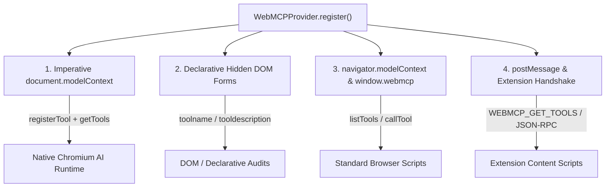
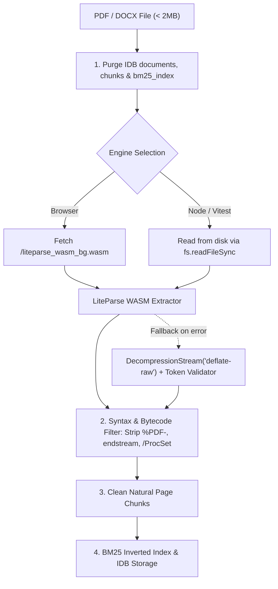

# Engineering Learnings

This document captures key architectural findings and resolution details from building bAssistant,
covering WebMCP tool discoverability with the official Chrome DevTools and Google Chrome Labs WebMCP
Inspector extensions (`GoogleChromeLabs/webmcp-tools` and
`beaufortfrancois/model-context-tool-inspector`), client-side Indic-script PDF rendering, and
in-browser PDF parsing with strict bytecode isolation.

## The Root Cause: Discovery Mismatch

When initially registering WebMCP tools via `window.webmcp` and early draft `navigator.modelContext`, the Chrome WebMCP Inspector side panel reported zero tools discovered. 

Investigation of the evolving W3C Web Machine Learning specification and Chrome implementation revealed three core divergence areas:

### 1. Specification Namespace Migration
- **Early Proposals**: Draft implementations placed tool registration on `navigator.modelContext` (`navigator.modelContext.registerTool(...)`).
- **Current Chromium Standard**: The specification relocated the authoritative imperative interface to **`document.modelContext`** (`document.modelContext.registerTool(...)` and `document.modelContext.getTools()`).
- **Testing Interface**: Chrome's flag-gated testing environment (`chrome://flags/#enable-webmcp-testing`) also inspects `navigator.modelContextTesting`.

### 2. Imperative vs. Declarative DOM Scanning
Inspector extensions perform both JavaScript runtime evaluations and DOM audits:
- **Imperative**: Looks for active instances of `document.modelContext.getTools()` or calls `registerTool(tool, { signal })`.
- **Declarative**: Scans the HTML DOM for `<form toolname="..." tooldescription="...">` elements with `<input toolparamdescription="...">` fields. Without corresponding DOM nodes, extensions relying on declarative scanning find no tools.

### 3. Tool Return Payload Structure
The Model Context Protocol specification requires tool execution handlers to return results in a structured content block:
```json
{
  "content": [
    {
      "type": "text",
      "text": "<result-string-or-json>"
    }
  ]
}
```
Returning a bare scalar or unformatted JSON object caused inspector client scripts to discard the response.

## Multi-Standard Resolution Strategy

In `src/webmcp/provider.ts`, bAssistant adopted a resilient multi-layer exposure pattern:



### Key Implementation Patterns

1. **Native Chrome Registration & Polyfill**:
   Registers each tool with `document.modelContext.registerTool(tool, { signal: controller.signal })` when the native browser flag is present, while provisioning fallback polyfill functions (`getTools`, `listTools`, `executeTool`) on `document.modelContext`.
2. **Automated Declarative Mirroring**:
   Dynamically synthesizes hidden `<form>` elements containing `toolname`, `tooldescription`, and `toolparamdescription` attributes matching all registered tools.
3. **Multi-Protocol `postMessage` Listener**:
   Listens for JSON-RPC 2.0 (`tools/list`, `tools/call`) as well as extension-specific signals (`WEBMCP_GET_TOOLS`, `MODEL_CONTEXT_GET_TOOLS`).

## Client-Side Multilingual Indic PDF Rendering

Supporting South Asian Indic scripts—specifically Bengali (`\u0980-\u09FF`) and Devanagari/Hindi (`\u0900-\u097F`)—in client-side PDF generators presented unique rendering hurdles.

### The Problem: Font Shaping & Missing Glyphs
Standard client-side PDF libraries like `jsPDF` rely on standard 14 PostScript typefaces (such as Helvetica and Times) that lack Unicode coverage for Indic glyphs, causing characters to render as blank spaces, unprintable question marks (`?`), or raw character codes. Furthermore, simply bundling raw `.ttf` font files into `jsPDF` fails because Indic scripts require complex OpenType typographic ligature shaping and conjunct conjunct re-ordering (e.g., matras preceding consonants or combined conjuncts like ক্ষ or ज्ञ), which standard PDF font engines do not perform.

### The Solution: 3x HiDPI Canvas2D Text Rasterization
Rather than bundling multi-megabyte HarfBuzz shaping binaries into the browser bundle, `bAssistant` utilizes the browser's native HarfBuzz-grade shaping engine via an off-screen HTML5 Canvas:

1. **Script Detection**:
   Regular expression test `containsIndicScript(text)` detects if a line contains Bengali or Devanagari codepoints.
2. **Dynamic Script Chunking & Word Wrapping**:
   Indic lines are wrapped via `wrapIndicText()` using the browser `CanvasRenderingContext2D.measureText()` to compute precise wrapping boundaries according to printable document width.
3. **3x Super-Sampling & Raster Placement**:
   Lines containing Indic scripts are drawn onto a scaled off-screen canvas (3x device pixel ratio) styled with system Indic fonts (`'Noto Sans Bengali', 'Noto Sans Devanagari', 'Kalpurush', 'SolaimanLipi', 'Mangal', sans-serif`).
4. **Seamless PDF Splicing**:
   The rasterized canvas is exported to a lossless PNG data URL and embedded directly into the jsPDF stream via `doc.addImage(...)`, while standard Latin text continues to use lightweight vector glyphs.

## In-Browser PDF Parsing, WASM Bundling & Bytecode Isolation

Running document parsing and BM25 full-text indexing 100% inside the browser sandbox presented subtle challenges around WebAssembly asset lifecycle, stream extraction fallback, and raw PDF bytecode leakage.

### The Problem: Raw Bytecode & PDF Object Leakage
When users uploaded non-standard, malformed, or highly compressed PDFs:
1. **Vite Dynamic Import Asset Fragmentation**:
   Using dynamic string imports (`await import(/* @vite-ignore */ url)`) bypassed Vite's static analysis, preventing the bundler from packaging the underlying `liteparse_wasm_bg.wasm` binary and leading to runtime loader failures in production.
2. **Bytecode Stream Leakage**:
   When fallback stream parsers processed raw deflate streams without strict token boundary checks, raw PDF object definitions (`%PDF-1.4`, `endstream`, `endobj`, `/ProcSet`, `/MediaBox`, `/ExtGState`) leaked into extracted text chunks.
3. **BM25 Search Contamination**:
   The BM25 index tokenized these PDF operators. Agent queries such as `"summary overview introduction"` matched structural dictionaries and returned unreadable PDF internals (`... Cl endstream endobj 2 0 obj <</Type /Page ...`).
4. **Cross-Document IndexedDB Accumulation**:
   If only the `documents` store was updated on file upload without purging the companion `chunks` and `bm25_index` stores, chunks from earlier sessions persisted and intermingled with subsequent document uploads.

### The Solution: Multi-Tier Extraction & Strict Bytecode Filtering



1. **Static WASM ESM Import with Environment Detection**:
   Importing `@llamaindex/liteparse-wasm` statically enables Vite's build pipeline to manage and fingerprint the `.wasm` asset. A universal detector initializes `/liteparse_wasm_bg.wasm` in browser environments and transparently falls back to local disk loading in Node.js test runners without external dependencies.
2. **Heuristic PDF Syntax Scrubbing**:
   The `cleanPdfSyntaxTokens()` sanitizer strips PDF structural delimiters (`%PDF-`, `endstream`, `endobj`, `/Font`, `/Length`, `/Filter /FlateDecode`, `/ProcSet`, `/MediaBox`) and rejects any extracted chunk containing residual binary bytecode before passing text to the chunk builder.
3. **Atomic IDB Store Reset**:
   `globalIDBStorage.saveDocument()` unconditionally clears the `documents`, `chunks`, and `bm25_index` stores prior to persisting newly parsed data, guaranteeing zero cross-document contamination.
