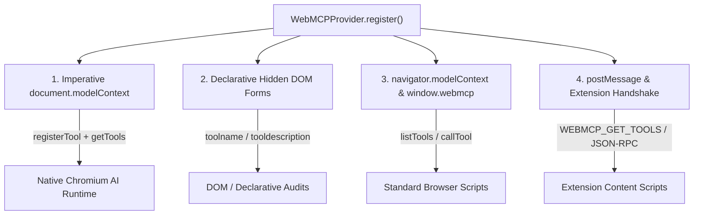

# WebMCP Tool Discovery Learnings

This document captures key architectural findings and resolution details regarding WebMCP tool discoverability with the official Chrome DevTools and Google Chrome Labs WebMCP Inspector extensions (`GoogleChromeLabs/webmcp-tools` and `beaufortfrancois/model-context-tool-inspector`).

## The Root Cause: Discovery Mismatch

When initially registering WebMCP tools via `window.webmcp` and early draft `navigator.modelContext`, the Chrome WebMCP Inspector side panel reported zero tools discovered. 

Investigation of the evolving W3C Web Machine Learning specification and Chrome implementation revealed three core divergence areas:

### 1. Specification Namespace Migration
- **Early Proposals**: Draft implementations placed tool registration on `navigator.modelContext` (`navigator.modelContext.registerTool(...)`).
- **Current Chromium Standard**: The specification relocated the authoritative imperative interface to **`document.modelContext`** (`document.modelContext.registerTool(...)` and `document.modelContext.getTools()`).
- **Testing Interface**: Chrome's flag-gated testing environment (`chrome://flags/#enable-webmcp-testing`) also inspects `navigator.modelContextTesting`.

### 2. Imperative vs. Declarative DOM Scanning
Inspector extensions perform both JavaScript runtime evaluations and DOM audits:
- **Imperative**: Looks for active instances of `document.modelContext.getTools()` or calls `registerTool(tool, { signal })`.
- **Declarative**: Scans the HTML DOM for `<form toolname="..." tooldescription="...">` elements with `<input toolparamdescription="...">` fields. Without corresponding DOM nodes, extensions relying on declarative scanning find no tools.

### 3. Tool Return Payload Structure
The Model Context Protocol specification requires tool execution handlers to return results in a structured content block:
```json
{
  "content": [
    {
      "type": "text",
      "text": "<result-string-or-json>"
    }
  ]
}
```
Returning a bare scalar or unformatted JSON object caused inspector client scripts to discard the response.

## Multi-Standard Resolution Strategy

In [`src/webmcp/provider.ts`](file:///C:/codebase/b_aassistant/src/webmcp/provider.ts), `bAssistant` adopted a resilient multi-layer exposure pattern:



### Key Implementation Patterns

1. **Native Chrome Registration & Polyfill**:
   Registers each tool with `document.modelContext.registerTool(tool, { signal: controller.signal })` when the native browser flag is present, while provisioning fallback polyfill functions (`getTools`, `listTools`, `executeTool`) on `document.modelContext`.
2. **Automated Declarative Mirroring**:
   Dynamically synthesizes hidden `<form>` elements containing `toolname`, `tooldescription`, and `toolparamdescription` attributes matching all registered tools.
3. **Multi-Protocol `postMessage` Listener**:
   Listens for JSON-RPC 2.0 (`tools/list`, `tools/call`) as well as extension-specific signals (`WEBMCP_GET_TOOLS`, `MODEL_CONTEXT_GET_TOOLS`).
