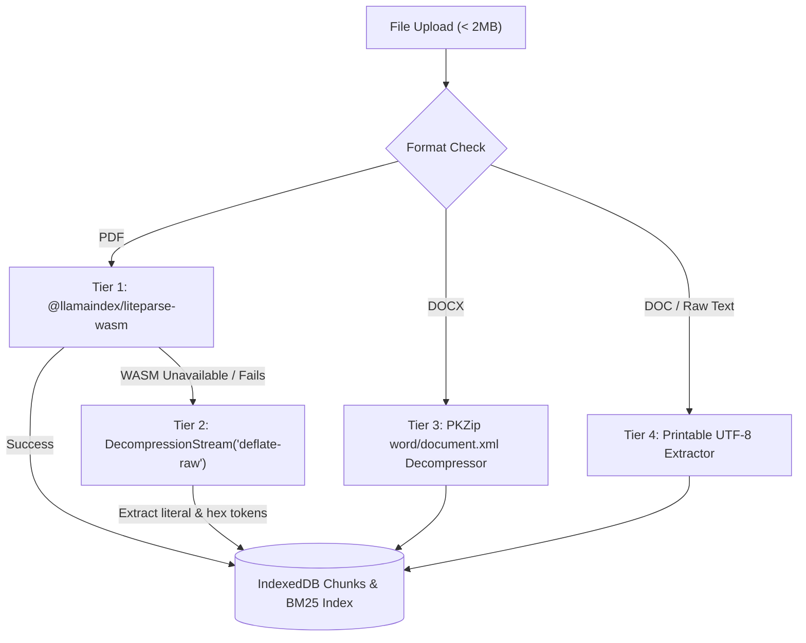

# In-Browser Document Parsing Research

This research document captures the technical architecture, capabilities, and fallback design for zero-backend document extraction in **bAssistant**, referencing findings from the official [run-llama/liteparse](https://github.com/run-llama/liteparse) project and browser WebAssembly constraints.

## Why Client-Side Parsing Matters
Traditional document ingestion pipelines transmit user files to cloud servers or remote multi-modal LLM endpoints, introducing latency, egress bandwidth costs, API secret exposure, and data privacy risks.

`bAssistant` processes all user documents strictly within the browser sandbox:
1. Files never leave the local machine.
2. Ingestion works completely offline.
3. Chunks and inverted indexes persist natively inside `IndexedDB` (`bAssistantDB`).

## Exploring `@llamaindex/liteparse-wasm`

The LlamaIndex team provides `@llamaindex/liteparse-wasm`, a WebAssembly compilation of LiteParse designed for browser and edge environments.

### 1. Module Initialization
```typescript
import initLiteParse, { LiteParse } from '@llamaindex/liteparse-wasm';

// Loads the bundled WebAssembly binary
await initLiteParse();

const parser = new LiteParse({
  ocrEnabled: false,
  outputFormat: 'text', // Options: 'text', 'json', 'markdown'
});
```

### 2. Passing In-Memory Byte Buffers
Unlike Node.js or Python environments that accept filesystem paths, the browser WASM package strictly accepts `Uint8Array` binary buffers:
```typescript
const arrayBuffer = await file.arrayBuffer();
const bytes = new Uint8Array(arrayBuffer);
const result = await parser.parse(bytes);

console.log(`Extracted ${result.totalPages} pages.`);
result.pages.forEach((page) => {
  console.log(`Page ${page.pageNum}:`, page.text || page.markdown);
});
```

### 3. What Works vs. What Requires Fallbacks in the Browser
| Capability | Browser WASM Status | Implementation in bAssistant |
| :--- | :--- | :--- |
| **PDF Text & Layout** | Supported natively | Primary extraction via `LiteParse.parse(bytes)` |
| **Multi-page Chunking** | Supported natively | Mapped to `StoredChunk` records per page |
| **Flate Compressed Streams** | Handled in WASM | Secondary fallback via `DecompressionStream('deflate-raw')` |
| **Hex PDF String Tokens** | Custom font encodings | Decoded via `decodeHexPdf` (<...> Tj / [...] TJ) |
| **DOCX Word Files** | Requires LibreOffice (Cloud only) | In-browser zero-dependency PKZip `word/document.xml` decompression |
| **OCR (Scanned PDFs)** | Requires JS OCR engine callback | Born-digital mode (`ocrEnabled: false`) bypasses heavy OCR |

## The Multi-Tier Extraction Architecture

To guarantee zero placeholder text (`Page X Content`) under all conditions (including browsers without full WASM compilation support or sandbox-restricted workers), `LiteParseService` operates in four resilient tiers:



### Tier 1: `@llamaindex/liteparse-wasm`
Executes the Rust-compiled WebAssembly engine to parse PDF structures, extracting genuine text and markdown layout per page.

### Tier 2: Native Browser `DecompressionStream`
Modern browsers natively implement `DecompressionStream('deflate-raw')`. PDFs compress their content streams using `/FlateDecode`. Tier 2 decompresses these streams in-memory and extracts both literal string tokens (`(...) Tj`) and hexadecimal byte streams (`<...> Tj` and `[...] TJ`) for fonts with custom character encodings.

### Tier 3: In-Browser DOCX Zip XML Decompressor
Directly reads PKZip central directory records to find `word/document.xml`, deflating via `DecompressionStream('deflate-raw')` and stripping XML markup tags without backend dependencies.

### Tier 4: Printable Text Extractor
For plain text, Word documents, or edge-case binaries, strips non-printable byte sequences and segments authentic document content into logical pages using form feeds (`\f`).

## Verification & Tool Integration

When a visiting LLM calls `search_document({ query: "*" })` or asks broad questions like *"what is in the documents"*:
1. The tool searches the client-side BM25 index over the authentic extracted chunks.
2. If the query consists of conversational framing words (stop words), the BM25 scorer automatically matches the introductory document chunks.
3. The LLM receives real document text, enabling accurate answers, summaries, and canvas diagramming.
