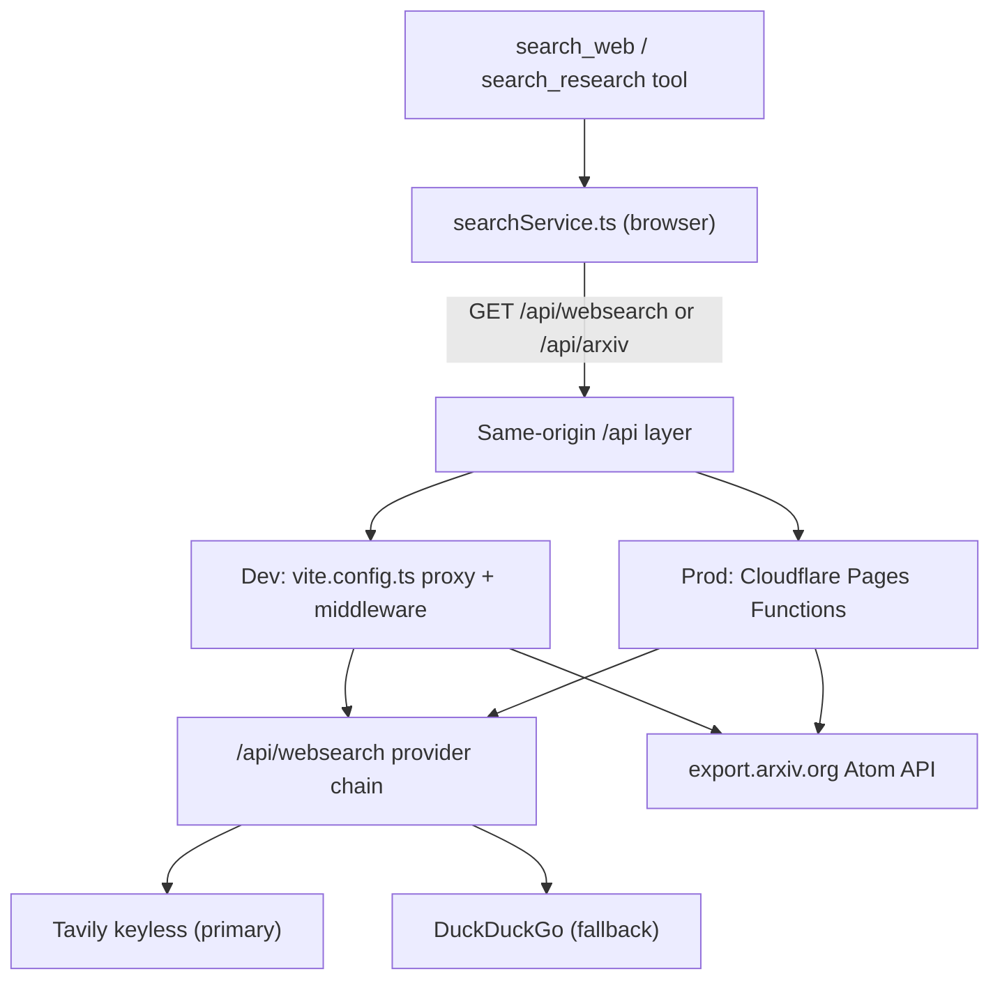

# Research & Math Tools

bAssistant ships free research and calculation tools so visiting agents do not need paid API keys. Web
search (`search_web`, Tavily-first with a DuckDuckGo fallback) and academic search (`search_research`)
run through a **same-origin `/api` layer** rather than fetching third-party hosts directly from the
browser — the browser blocks some direct calls with CORS, so the proxy is what makes the tools work at
all. See [Keyless Tavily Search & Fallback](/tavily-search) for the web-search provider detail.

## Why a proxy layer

`export.arxiv.org` and `api.duckduckgo.com` do not send `Access-Control-Allow-Origin` headers, so a
`fetch()` from the app origin is rejected and surfaces as `TypeError: Failed to fetch`. bAssistant
therefore calls relative `/api/*` URLs that resolve identically in both environments:

- **Development** — `vite.config.ts` proxies `/api/arxiv` to `https://export.arxiv.org` and mounts a
  dev middleware (`dev-search-endpoints`) for `/api/websearch`.
- **Production** — Cloudflare Pages Functions in `functions/api/` serve the same two routes; the
  Tavily client (`src/lib/tavilySearch.ts`) and the shared DuckDuckGo parser (`src/lib/ddgSearch.ts`)
  run identically in dev and prod.

`public/_routes.json` restricts Pages Function invocation to `/api/*`, keeping every other path a
plain static asset.

## Available Tools

### 1. `search_web`
- **Provider**: Keyless **Tavily AI** search (`searchTavilyKeyless()` in `src/lib/tavilySearch.ts`) is tried first; on error, rate limit (HTTP 429), or an empty result set the proxy falls back to DuckDuckGo HTML results parsed by `searchDuckDuckGo()` in `src/lib/ddgSearch.ts`. The parser (`parseDdgHtml`) reads each snippet from its own result block, drops ad/redirect links and non-`http(s)` URLs, and treats a bot-challenge page as an `unavailable` failure rather than an empty success. See [DuckDuckGo Fallback & Parser Nuances](/ddg-search).
- **Endpoint**: `GET /api/websearch?query={query}` (dev middleware or `functions/api/websearch.ts`).
- **Output**: Live top-5 `{ title, snippet, url }` results with `source: 'tavily' | 'duckduckgo'` — real current web results, not encyclopedic abstracts.

### 2. `search_research`
- **Provider**: ArXiv public Atom API.
- **Endpoint**: `GET /api/arxiv?search_query=all:{query}&start=0&max_results=5` (dev proxy or `functions/api/arxiv.ts`).
- **Output**: Paper titles, summaries, author lists, and ArXiv IDs.

### 3. `calculate`
- **Implementation**: Pure JavaScript sanitized evaluator with precision rounding.
- **Capabilities**: Standard operators (`+`, `-`, `*`, `/`, `×`, `÷`, `^`), parenthetical groupings, and floating-point correction.

## Freshness & Failure Semantics

Both search functions return a `SearchOutcome` object rather than a bare array:

- Every result carries `fetchedAt` (ISO timestamp) and `source` (`tavily` / `duckduckgo` / `arxiv`) so
  the agent can judge freshness, verified by unit tests.
- On any fetch failure the outcome is `{ results: [], unavailable: true, error }` — the service **never**
  fabricates a placeholder result. `get_tool_usage_prompt` instructs agents to report unavailability to
  the user instead of inventing answers.
- Requests are bounded by a 20-second `AbortController` timeout.
