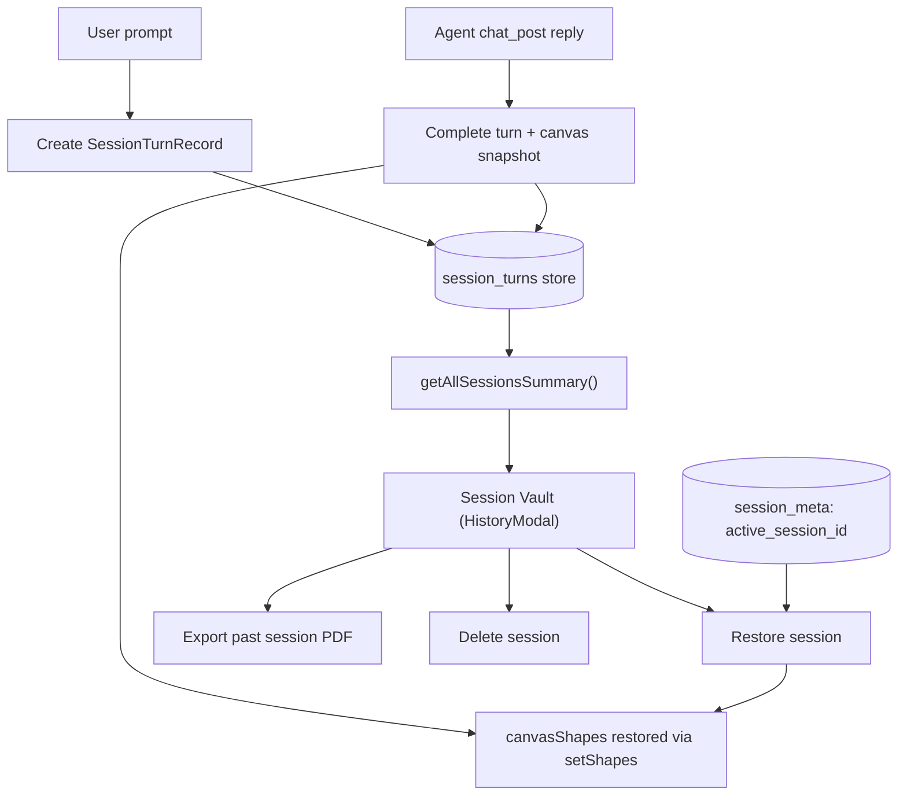

# Session Vault & Local Persistence

Every deliberation in bAssistant is captured as an ordered list of **turns** and stored entirely in
the browser's IndexedDB. Because there is no backend, the "session vault" is simply a set of
client-side stores that survive page reloads — the same stores the app rehydrates on first paint.

## Session Model

A session is identified by a `sessionId` generated as `sess_<timestamp>_<random>`. Its content is a
sequence of `SessionTurnRecord` rows, where a **turn** pairs a user inquiry with the agent reply that
follows it:

| Field | Type | Notes |
| :--- | :--- | :--- |
| `id` | `string` | Unique turn id |
| `sessionId` | `string` | Owning session |
| `turnNumber` | `number` | Sequential position within the session |
| `userPrompt?` | `string` | The user's message (absent on standalone agent turns) |
| `agentMessage?` | `string` | The agent's reply |
| `canvasSnapshot?` | `string \| null` | PNG data URL of the canvas at that turn |
| `canvasShapes?` | `unknown[]` | Serialized `Canvas2dShape[]` for precise restore |
| `timestamp` | `number` | Epoch milliseconds |

A turn is created when the user sends a prompt and completed when the agent posts its reply. If an
agent messages without a pending user turn, a standalone agent turn (`userPrompt` undefined) is
recorded instead.

## IndexedDB Schema

All persistence lives in a single database, `bAssistantDB`, at **version 2** (the session stores were
added on the version bump). It holds five object stores:

| Store | Key path | Indexes | Purpose |
| :--- | :--- | :--- | :--- |
| `documents` | `id` | — | Active uploaded document metadata |
| `chunks` | `id` | `docId` | Natural per-page text chunks |
| `bm25_index` | `id` | — | Serialized BM25 inverted index (fixed key `default_index`) |
| `session_turns` | `id` | `sessionId`, `timestamp` | Sequential deliberation turns |
| `session_meta` | `key` | — | Key-value metadata (`active_session_id`) |

The session stores are written by `globalIDBStorage` (`src/lib/idbStorage.ts`):
`saveSessionTurn`, `getActiveSessionTurns(sessionId)` (sorted by timestamp then turn number),
`clearSessionTurns`, `getAllSessionsSummary`, `deleteSession`, and `getActiveSessionId` /
`setActiveSessionId`. `clearAll()` wipes all five stores; note that document upload only clears
`documents`, `chunks`, and `bm25_index` — session turns are intentionally preserved.

## Restore-on-Mount

When the app loads, an effect in `src/App.tsx` rehydrates everything from IndexedDB:

1. Load the active document metadata, the BM25 index, and the document chunks — then `loadData()` the
   index into a fresh `BM25Index`.
2. Resolve the `active_session_id` from `session_meta`; if none exists, persist the freshly generated
   one.
3. Load that session's turns and rebuild the chat stream by walking each turn (emitting a
   `user-<turnId>` message and, when present, an `agent-<turnId>` message).
4. Restore the most recent non-empty `canvasShapes` array onto the live canvas via
   `globalCanvasEngine.setShapes(...)`, or clear the canvas when the session has none.

## The Vault UI

The vault is rendered by `src/components/HistoryModal.tsx`, a presentational modal driven entirely by
`App.tsx`. Its list comes from `getAllSessionsSummary()`, which folds every session's turns into a
`SessionSummary`:

- **`firstPrompt`** — the first user prompt, or a truncated agent message, or `Untitled Session`.
- **`turnCount`** — number of recorded turns.
- **`createdAt` / `latestCreatedAt`** — earliest and latest turn timestamps (used for sorting and the
  displayed date).

Each session card shows the first prompt, a **turn count**, a formatted date, and an **Active** pill
for the current session. Three actions are available:

- **Restore** — loads the session's turns, adopts its `sessionId`, rebuilds the message stream, and
  restores its latest canvas scene graph. Hidden for the already-active session.
- **PDF** — rebuilds messages from the stored turns, finds the latest `canvasSnapshot`, and exports a
  report via `exportSessionPdf` (see [Canvas2D & PDF Export](/canvas-and-pdf)).
- **Delete** — removes the session's turns; deleting the active session starts a fresh one.

Starting a **New Session** from the canvas toolbar generates a new `sessionId`, clears turns, messages,
and the canvas, and makes it active — while the previous session remains available in the vault.

## What Persists Where

| Mechanism | Key | Contents |
| :--- | :--- | :--- |
| `localStorage` | `b_theme` | Selected light/dark theme |
| `localStorage` | `b_onboarded` | Onboarding-seen flag |
| `localStorage` | `b_reference_urls` | Up to 10 cached reference URLs |
| `localStorage` | `b_font_size` | Chat reader font step (15 / 17 / 19) |
| `localStorage` | `bassistant_gemini_api_key` | AES-GCM-256-encrypted Gemini API key (`__BASSISTANT_ENC__:v1:<iv>:<ciphertext>`) |
| `localStorage` | `bassistant_voice_live_model` | Selected Tier 1 live model |
| `localStorage` | `bassistant_subagent_model` | Selected Tier 2 subagent model |
| `localStorage` | `bassistant_studio_voice` | Selected voice persona (e.g. `Puck`) |
| IndexedDB | `bAssistantDB` | Documents, chunks, BM25 index, session turns, active session id |
| IndexedDB | `bassistant_secure_vault` | Non-extractable device master key (`bassistant_keys` store, `bassistant_device_master_key_v1`) used to encrypt voice credentials |
| `sessionStorage` | `bassistant_background_tasks` | Background voice task records (per-tab, LRU cap of 20) — see [Background Task Handling](/background-tasks) |

Everything above is client-local: no session data, document text, canvas content, or API key ever
leaves the machine. The voice credential keys are migrated from legacy names (`GEMINI_API_KEY`,
`VOICE_LIVE_MODEL`, `GEMINI_MODEL`, `STUDIO_VOICE`) on load — see [Live Voice Agent](/voice-agent).
