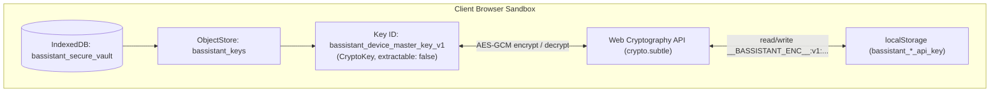

# Storage Keys & Encrypted Vault Schema

bAssistant operates strictly as a zero-backend workstation. All user configuration, session deliberation history, and LLM credentials reside entirely in the client's local browser sandbox.

To prevent key collisions with other applications, browser extensions, or localhost services, **all configuration keys, vault database names, object stores, and encrypted ciphertext payloads are strictly namespaced with the `bassistant_` prefix**.

---

## 1. Complete `localStorage` Namespaced Keys

Every setting managed by `useVoiceSettings` and the cockpit persists under a dedicated `bassistant_` key:

| Storage Key | Type | Description | Security |
| :--- | :--- | :--- | :--- |
| `bassistant_gemini_api_key` | `string` | Primary Google Gemini API key used for Tier 1 Live Audio and default Tier 2 Subagent | 🔒 AES-GCM-256 Encrypted |
| `bassistant_gemini_subagent_key` | `string` | Dedicated Tier 2 Gemini API key override (used when Tier 1 reuse is disabled) | 🔒 AES-GCM-256 Encrypted |
| `bassistant_openai_api_key` | `string` | OpenAI API key for Tier 2 diagram & explanation subagent | 🔒 AES-GCM-256 Encrypted |
| `bassistant_mistral_api_key` | `string` | Mistral AI API key for Tier 2 diagram & explanation subagent | 🔒 AES-GCM-256 Encrypted |
| `bassistant_requesty_api_key` | `string` | Requesty AI API key for Tier 2 diagram & explanation subagent | 🔒 AES-GCM-256 Encrypted |
| `bassistant_ollama_api_key` | `string` | Ollama Cloud Bearer token for hosted open-source models | 🔒 AES-GCM-256 Encrypted |
| `bassistant_subagent_provider` | `string` | Active Tier 2 provider: `'gemini'`, `'openai'`, `'mistral'`, `'requesty'`, or `'ollama'` | Plain text |
| `bassistant_subagent_model` | `string` | Selected Subagent model ID string (preset or custom identifier) | Plain text |
| `bassistant_use_tier1_gemini_key` | `string` | Flag (`'true'` / `'false'`) controlling whether Gemini subagent inherits the Tier 1 key | Plain text |
| `bassistant_voice_live_model` | `string` | Tier 1 Live conversational audio model (default: `'gemini-3.8-live'`) | Plain text |
| `bassistant_studio_voice` | `string` | Selected studio voice persona (e.g. `'Puck'`, `'Charon'`, `'Kore'`, `'Fenrir'`, `'Aoede'`) | Plain text |
| `bassistant_ollama_endpoint` | `string` | Cloud API base URL for Ollama Cloud (default: `'https://ollama.com/api'`) | Plain text |
| `b_user_preferences` | `string[]` | User preferences array (max 10 items, max 120 chars each) for WebMCP & subagent prompt injection | Plain text JSON |

---

## 2. In-Session Cache Keys (`sessionStorage`)

Transient background tasks dispatched during live deliberation are tracked without polluting permanent storage:

| Storage Key | Storage | Description |
| :--- | :--- | :--- |
| `bassistant_background_tasks` | `sessionStorage` | LRU-capped cache (20 items) tracking active and completed background subagent tasks (`bassistant_task_*`) |

---

## 3. Encrypted Ciphertext Envelope Format

Sensitive credentials stored in `localStorage` are never written as plaintext. The cryptographic layer in `src/voice/config/cryptoStorage.ts` packs encrypted payloads into a versioned, verifiable string envelope:

```text
__BASSISTANT_ENC__:v1:<iv_hex>:<ciphertext_hex>
```

### Envelope Structure:
- **Header Prefix**: `__BASSISTANT_ENC__:v1:` explicitly identifies bAssistant-managed ciphertext and version.
- **Initialization Vector (`<iv_hex>`)**: 96-bit (12-byte) cryptographically secure random IV generated via `window.crypto.getRandomValues(new Uint8Array(12))`.
- **Ciphertext (`<ciphertext_hex>`)**: 256-bit AES-GCM ciphertext containing the encrypted string and authentication tag.

---

## 4. IndexedDB Cryptographic Vault (`bassistant_secure_vault`)

The encryption key used to seal and open credentials is maintained in a dedicated IndexedDB database with hardware/browser isolation:



### Vault Parameters:
- **Database Name**: `bassistant_secure_vault`
- **Object Store**: `bassistant_keys`
- **Master Key Record ID**: `bassistant_device_master_key_v1`
- **Key Algorithm**: `AES-GCM` with 256-bit key length.
- **Key Usages**: `['encrypt', 'decrypt']`.
- **Non-Extractable Guarantee**: Generated with `extractable: false`. The raw key bytes can never be exported or read by JavaScript; the key can only be referenced by `crypto.subtle` inside the device's cryptographic sandbox.

---

## 5. Main Application Database (`bAssistantDB`)

User documents, lexical search indices, and multi-session deliberation history are stored in the primary IndexedDB instance:

| Store Name | Primary Key | Description |
| :--- | :--- | :--- |
| `documents` | `id` | Metadata for uploaded PDF/DOCX files (< 2MB) |
| `chunks` | `id` | Extracted page text chunks and token arrays |
| `bm25_index` | `id` (`default_index`) | Precomputed BM25 inverted index for instantaneous client-side document search |
| `session_turns` | `id` (`${sessionId}_turn_${index}`) | Deliberation turns (user prompt, canvas diagram snapshot, AI response) |
| `session_meta` | `id` (`session_meta_${sessionId}`) | Session metadata (turn counts, creation timestamp, title) |
| `reference_urls` | `id` (`default_urls`) | Up to 10 verified external reference links |

---

## 6. Migration & Legacy Key Protection

On application startup, `useVoiceSettings` automatically performs clean migration:
- If legacy un-prefixed keys (e.g. `GEMINI_API_KEY`, `VOICE_LIVE_MODEL`, `GEMINI_MODEL`, `STUDIO_VOICE`) are discovered in `localStorage`, their values are transparently read, encrypted, migrated to their corresponding `bassistant_*` keys, and the un-prefixed keys are purged (`localStorage.removeItem`).
- If legacy ciphertext prefix (`__ENC__:v1:`) is encountered, it is automatically decrypted and re-encrypted with the official `__BASSISTANT_ENC__:v1:` envelope.
