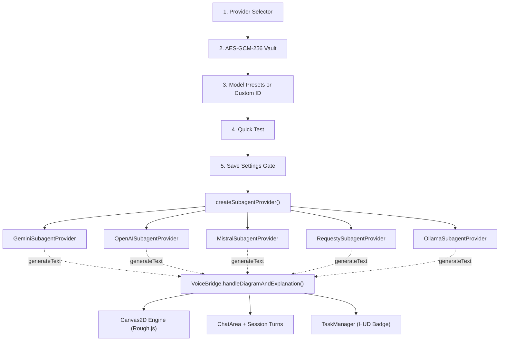

# Tier 2 Subagent Providers & Multi-Model Engine

In bAssistant, conversational dialogue and heavy technical synthesis are strictly decoupled into a **two-tier agent topology**. While **Tier 1** handles real-time conversational banter and 16 kHz audio streaming, the **Tier 2 Subagent** runs asynchronously in the background to render procedural Rough.js canvas diagrams and post rich technical markdown explanations.

bAssistant features a pluggable, interface-driven multi-provider architecture for Tier 2:
- **Google Gemini** (Native GenAI SDK)
- **OpenAI** (Frontier reasoning and compact models via `gpt-6-luna` & `gpt-5-nano`)
- **Mistral AI** (Direct REST with European open/commercial frontier models)
- **Requesty AI** (High-throughput OpenAI-compatible router with native CORS)
- **Ollama Cloud** (Cloud-hosted open models via Bearer token authentication)
- **Custom Model IDs** (Arbitrary model string routing across any provider)
- **Pre-Save Quick Test** (In-memory connectivity and latency verification before saving)

---

## 1. Architectural Topology & Interface Contract

All subagent providers implement the uniform `ISubagentProvider` interface, allowing `VoiceBridge` to remain completely model-agnostic:



### The `ISubagentProvider` Interface

```typescript
export interface ISubagentProvider {
  readonly id: string;
  readonly name: string;
  generateText: (prompt: string, systemInstruction?: string) => Promise<string>;
}
```

---

## 2. Supported Provider Implementations

### Google Gemini (`GeminiSubagentProvider`)
- **Integration**: Direct client-side SDK integration via `@google/genai` (`ai.models.generateContent`).
- **Authentication**: Can inherit the primary Tier 1 Gemini API key (via *"Use Tier 1 Gemini API Key"* toggle) or use a dedicated Tier 2 API key override.
- **Recommended Presets**:
  - `gemini-3.5-flash-lite` (Recommended for high-throughput diagrams)
  - `gemini-3.1-flash-lite`
  - `gemini-2.5-flash`

### OpenAI (`OpenAISubagentProvider`)
- **Integration**: REST chat completions endpoint `https://api.openai.com/v1/chat/completions`.
- **CORS Resolution**: Dispatched via same-origin `/api/proxy` (Vite dev middleware & Cloudflare Pages Functions) to eliminate browser CORS blocks.
- **Authentication**: Bearer token via `Authorization: Bearer <OPENAI_API_KEY>`.
- **Recommended Presets**:
  - `gpt-6-luna` (Default frontier reasoning and architectural design subagent)
  - `gpt-5-nano` (Fast, lightweight compact subagent)

### Mistral AI (`MistralSubagentProvider`)
- **Integration**: REST chat completions endpoint `https://api.mistral.ai/v1/chat/completions`.
- **CORS Resolution**: Dispatched via same-origin `/api/proxy` (Vite dev middleware & Cloudflare Pages Functions) to eliminate browser `403 (Forbidden)` cross-origin errors.
- **Authentication**: Bearer token via `Authorization: Bearer <MISTRAL_API_KEY>`.
- **Recommended Presets**:
  - `ministral-14b-2512` (Default high-capability dense subagent)
  - `ministral-8b-2512` (Balanced reasoning & synthesis)
  - `ministral-3b-2512` (Fast, lightweight edge subagent)

### Requesty AI (`RequestySubagentProvider`)
- **Integration**: OpenAI-compatible router with Base URL `https://router.requesty.ai/v1` (auto-resolving completions to `https://router.requesty.ai/v1/chat/completions`).
- **CORS & CSP Handling**: Requesty natively supports browser CORS with `Access-Control-Allow-Origin: *`. Content Security Policy (`connect-src`) in `public/_headers` explicitly allows `https://router.requesty.ai` and `https://*.requesty.ai`. In restricted corporate networks, requests automatically fall back to the same-origin `/api/proxy`.
- **Vendor-Qualified Slugs**: Requesty's router routes requests via vendor-qualified slugs (e.g., `google/gemma-4-31b-it`).
- **Authentication**: Bearer token via `Authorization: Bearer <REQUESTY_API_KEY>`.
- **Recommended Presets**:
  - `google/gemma-4-31b-it` (Default dense multimodal and structured payload engine)
  - `nvidia/muse-glimmer-30b` (Superior synthesis & architecture)

### Ollama Cloud (`OllamaSubagentProvider`)
- **Integration**: Remote cloud API endpoint `https://ollama.com/api/chat` or local Ollama daemon (`http://localhost:11434/api/chat`).
- **CORS Resolution**: Because `ollama.com` does not return `Access-Control-Allow-Origin` on browser OPTIONS preflights, remote requests are dispatched through the same-origin `/api/proxy` (Vite dev middleware & Cloudflare Pages Functions) to bypass browser CORS checks.
- **Dual-Track Dispatch**:
  - **Remote / Cloud**: Automatically routed via same-origin `/api/proxy`.
  - **Local (`localhost`/`127.0.0.1`)**: Direct browser fetch attempted first (succeeding when local Ollama runs with `OLLAMA_ORIGINS="*"`); falls back to `/api/proxy` on network or CORS rejection.
- **Authentication**: Bearer token via `Authorization: Bearer <OLLAMA_API_KEY>` (mandatory for cloud endpoints; optional for local daemons).
- **Recommended Presets**:
  - `gemma4:31b-cloud` (Default high-capability reasoning subagent)
  - `nemotron-3-super:cloud` (Superior architecture & synthesis)
  - `nemotron-3-nano:30b-cloud` (Compact fast reasoning)
  - `beam:cloud` (Optimized inference subagent)

---

## 3. Custom Model ID Support

In addition to curated presets, every provider supports arbitrary model identifiers:
1. Select **⚙️ Custom Model ID...** in the Subagent Model dropdown.
2. A monospace input field appears allowing any valid model string (e.g. `meta-llama/llama-3.3-70b-instruct`, `mistralai/mistral-large-2407`, `my-org/fine-tuned-model`).
3. The custom model string is validated during the quick test and saved directly to `localStorage['bassistant_subagent_model']`.

---

## 4. ⚡ Interactive Quick Test & Save Gating

To prevent broken background tasks caused by typos or invalid API keys, bAssistant features an **interactive connection preflight protocol**:

1. **In-Memory Verification**: Clicking **⚡ Run Quick Test** instantiates the provider in memory using the values currently in the modal fields.
2. **Ping Probe**: Sends a lightweight prompt: `"Respond with only the word OK to verify connection."`
3. **Live Diagnostics**:
   - **In Progress**: Displays an animated spinner with `"Testing..."`.
   - **Success**: Displays a green badge with latency tracking (`✓ Connection verified in 380ms: "OK"`).
   - **Failure**: Displays the exact HTTP error or rejection reason (e.g. `401 Unauthorized`, `Invalid model ID`).
4. **Save Gating Rule**:
   - If Tier 2 provider, key, or model settings are changed, the **Save Settings** button is disabled until the Quick Test succeeds.
   - Pristine (unmodified) settings can be saved or closed immediately.

---

## 5. Client-Side Cryptographic Vault

All API keys are isolated per provider in client-side encrypted storage:
- **Keys Stored**:
  - `bassistant_gemini_api_key`: Tier 1 & default Tier 2 Gemini key.
  - `bassistant_gemini_subagent_key`: Dedicated Tier 2 Gemini key override.
  - `bassistant_openai_api_key`: OpenAI API key.
  - `bassistant_mistral_api_key`: Mistral AI API key.
  - `bassistant_requesty_api_key`: Requesty AI API key.
  - `bassistant_ollama_api_key`: Ollama Cloud API key.
- **Encryption**: 256-bit AES-GCM (`window.crypto.subtle`) using non-extractable keys in IndexedDB (`bassistant_secure_vault`).
- **Provider Switching**: Switching providers retains previously entered keys in their respective encrypted slots so keys never need to be retyped.
- **Full Storage Schema**: See the comprehensive key catalog in [Storage Keys & Encrypted Vault Schema](/storage-keys).
