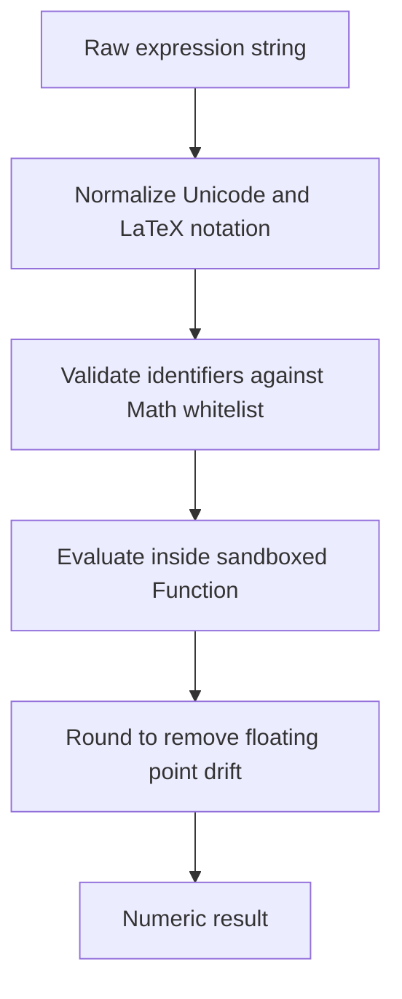

# Symbol Humanization & Scientific Math

Two independent string utilities sit behind the readable chat stream and the exportable PDF report:

- **`src/lib/symbolHumanizer.ts`** — turns the LaTeX and Unicode notations emitted by models into
  clean display Unicode, and into Latin-1 safe ASCII for the PDF font stack.
- **`src/lib/mathEvaluator.ts`** — a sandboxed scientific expression evaluator, surfaced to agents as
  the `calculate` WebMCP tool.

Both are pure, dependency-free modules and are covered by hermetic unit tests
(`symbolHumanizer.test.ts`, `mathEvaluator.test.ts`).

## `humanizeSymbols(text)` — UI normalization

`humanizeSymbols` rewrites LaTeX commands into Unicode, unwraps `\text{...}` / `\mathrm{...}` /
`\mathbf{...}` / `\mathit{...}` groups, and strips enclosing `$…$` math delimiters while **protecting
currency amounts** (`$100`, `$50M`, `$12.50` are left intact).

The `LATEX_TO_UNICODE` table covers arrows, relations, arithmetic, set theory, and the full Greek
alphabet. Scientific and calculus commands were added alongside them:

| LaTeX | Unicode | | LaTeX | Unicode |
| :--- | :--- | :--- | :--- | :--- |
| `\sqrt` | `√` | | `\prod` | `∏` |
| `\cbrt` | `∛` | | `\int` | `∫` |
| `\deg` / `\degree` | `°` | | `\hbar` | `ℏ` |
| `\sum` | `∑` | | `\nabla` | `∇` |

The `MATH_OPERATOR_REGEX` used to detect math content inside `$…$` delimiters was widened to include
`√`, `²`, `³`, and `°`, so root and superscript expressions are correctly unwrapped.

## `humanizeSymbolsForPdf(text)` — Latin-1 safe export

The PDF export runs text through `humanizeSymbols` first, then transliterates every Unicode symbol via
`UNICODE_TO_PDF_ASCII` so the standard jsPDF core fonts never emit broken `?` glyphs or mojibake. The
scientific additions:

| Unicode | ASCII | | Unicode | ASCII |
| :--- | :--- | :--- | :--- | :--- |
| `√` | `sqrt` | | `∑` | `SUM` |
| `∛` | `cbrt` | | `∏` | `PROD` |
| `²` | `^2` | | `∫` | `INT` |
| `³` | `^3` | | `ℏ` | `hbar` |
| `⁴` `¹` `⁰` | `^4` `^1` `^0` | | `∇` | `nabla` |
| `°` | ` deg` | | `Δ` `Ω` | `Delta` `Omega` |
| `⋅` | `*` | | `θ` `τ` `φ` | `theta` `tau` `phi` |
| `−` | `-` | | | |

These join the existing arrow, relation, and Greek transliterations (`→`→`->`, `≤`→`<=`, `≠`→`!=`,
`α`→`alpha`, …). See [Canvas2D Scene Graph & PDF Export](/canvas-and-pdf) for where this runs in the
report pipeline.

## `calculate(expression)` — scientific evaluator

The `calculate` tool delegates to `calculateMath(expression: string): number`. It is **not** a plain
`eval`: input is normalized, every identifier is checked against a whitelist, and the final string must
contain only safe characters before it is evaluated inside a sandboxed `Function`.

### Normalization pipeline

| Input notation | Rewritten to |
| :--- | :--- |
| `×` `·` `⋅` | `*` |
| `÷` `∕` `⁄` | `/` |
| `−` `–` `—` | `-` |
| `√16` / `√(x)` | `sqrt(16)` / `sqrt(x)` |
| `∛27` | `cbrt(27)` |
| `²` / `³` | `**2` / `**3` |
| `^` | `**` |
| `3 x 4` | `3 * 4` |
| `pi` / `π` | `PI` |
| `e` | `E` |
| `ln(` | `log(` |

Scientific notation such as `1.5e-3` is preserved (an `e` immediately after a digit or `.` is left as
an exponent rather than mapped to Euler's number).

### Whitelisted functions and constants

Only these identifiers are allowed (`SAFE_MATH_NAMES` plus the `PI` / `E` constants):

`sqrt`, `cbrt`, `sin`, `cos`, `tan`, `asin`, `acos`, `atan`, `log`, `log10`, `log2`, `exp`, `abs`,
`round`, `floor`, `ceil`, `min`, `max`, `PI`, `E`.

Each whitelisted name is prefixed with `Math.` (so `sqrt(16)` becomes `Math.sqrt(16)`). Any other
identifier — `alert`, `window`, `document`, `eval`, a stray variable — throws
`Invalid mathematical expression: unsupported identifier "…"`, and a final character-class check rejects
anything outside digits, operators, parentheses, commas, dots, and the letters used by the whitelisted
functions. There is no path to arbitrary code execution, and no CAS features (symbolic differentiation or
equation solving) are provided.

### Precision

Results are rounded to remove IEEE-754 drift, so `0.1 + 0.2` returns `0.3` rather than
`0.30000000000000004`. Non-finite results (division by zero, `NaN`) are rejected with
`Expression evaluated to a non-finite number`.

## Related pages

- [Research & Math Tools](/research-tools) — where `calculate` sits in the tool suite.
- [Canvas2D Scene Graph & PDF Export](/canvas-and-pdf) — the export pipeline that calls
  `humanizeSymbolsForPdf`.
- [WebMCP Standard Implementation](/webmcp) — how the tool is registered and discovered.
