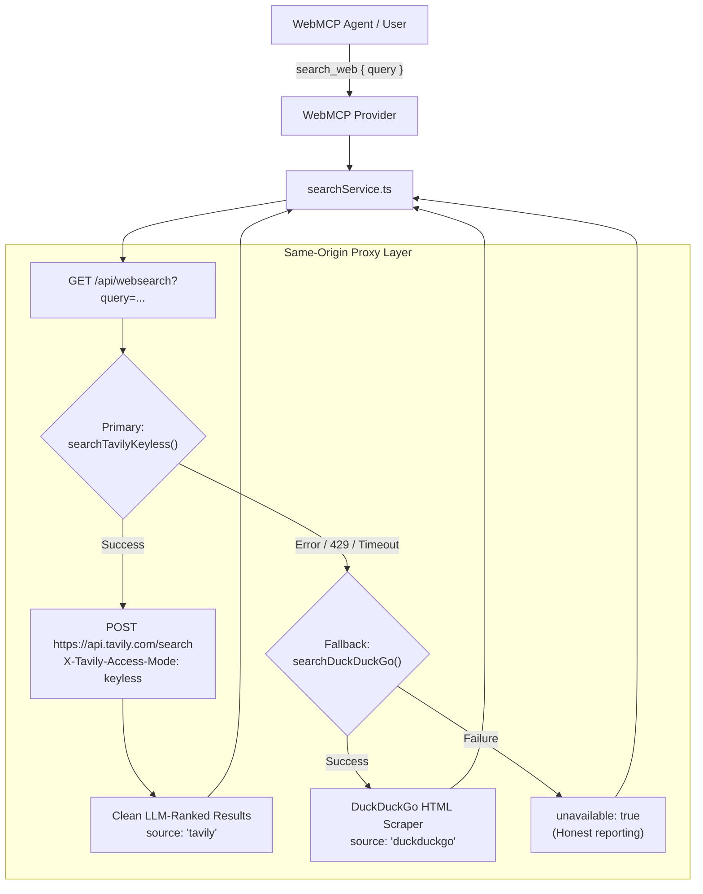

# Keyless Tavily Search & Fallback

bAssistant utilizes **Tavily AI Search** as its primary web intelligence engine, giving visiting LLMs and users high-signal, clean, and ranked search results without requiring an account, credit card, or API key.



---

## Why Tavily Keyless Search?

Standard web search engines return raw HTML blobs or shallow encyclopedic abstracts, forcing language models to burn tokens parsing navigation bars, boilerplate, and ads.

Tavily is designed specifically for autonomous agents and LLMs:
- **Clean LLM Snippets**: Extracts substantive paragraphs directly from destination pages, stripped of scripts and boilerplate.
- **Pre-Scored Relevance**: Each result includes a search relevance score (`score: 0.0 - 1.0`).
- **Zero-Setup Keyless Mode**: Uses `X-Tavily-Access-Mode: keyless` over standard HTTPS POST requests, requiring zero configuration.

---

## The Keyless Request Protocol

The standalone client implementation lives in `src/lib/tavilySearch.ts`:

```typescript
export async function searchTavilyKeyless(query: string, limit = 5): Promise<TavilySearchResult[]> {
  const response = await fetch('https://api.tavily.com/search', {
    method: 'POST',
    headers: {
      'Content-Type': 'application/json',
      'X-Tavily-Access-Mode': 'keyless',
    },
    body: JSON.stringify({
      query: query.trim(),
      max_results: Math.max(1, Math.min(limit, 10)),
    }),
  });
  // ...
}
```

### Request Headers & Body
- **Method**: `POST`
- **URL**: `https://api.tavily.com/search`
- **Headers**:
  - `Content-Type: application/json`
  - `X-Tavily-Access-Mode: keyless`
- **Body**: `{"query": "...", "max_results": 5}`

---

## Automatic DuckDuckGo Fallback

Keyless access is free and subject to rate limits. When usage caps are reached or the Tavily endpoint returns an HTTP 429 / error:

1. The same-origin proxy (`functions/api/websearch.ts` in production or `vite.config.ts` in development) catches the error silently.
2. It immediately executes `searchDuckDuckGo()` as a fallback.
3. The response metadata clearly identifies the active provider (`source: 'tavily'` or `source: 'duckduckgo'`) along with an ISO `fetchedAt` timestamp.
4. If both providers fail, the service returns `{ results: [], unavailable: true }` so the model honestly reports network unavailability rather than hallucinating facts.

---

## Testing & Verification

The Tavily search integration is covered by hermetic Vitest suites:
- `src/tests/tavilySearch.test.ts`: Validates request headers, body payload construction, content mapping, empty query handling, and non-200 status handling.
- `src/tests/searchService.test.ts`: Verifies dynamic source attribution (`tavily` vs. `duckduckgo`) and failure semantics.
