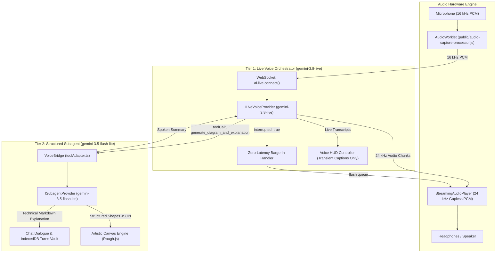

# Full-Duplex Live Voice Agent

bAssistant features a **full-duplex, bidirectional live voice mode** powered by the **Google Gemini Live API** (`@google/genai`), mid-dialogue **WebMCP tool access**, client-side **AES-GCM-256 key encryption**, and a **decoupled two-tier agent topology**.



---

## 1. Architectural Topology: Two-Tier Agent System

Real-time audio models (`gemini-3.8-live`, `gemini-2.5-flash-native-audio-preview-12-2025`) are optimized for low-latency conversational audio, natural speech inflection, and rapid turn-taking. However, requiring native-audio models to synthesize massive JSON payloads or dense vector structures mid-speech introduces audio stutter and token bloat.

To solve this, bAssistant decouples conversational speech from heavy technical synthesis:
1. **Tier 1 (Audio Orchestrator)**: `gemini-3.8-live` handles real-time conversational banter, microphone audio streaming, and voice personality.
2. **Tier 2 (Structured Subagent)**: `gemini-3.5-flash-lite` generates dense Canvas2D shapes and comprehensive markdown breakdowns when the user asks for diagrams, system designs, or calculations.

---

## 2. Ephemeral Voice vs. Subagent Persistence

To maintain executive clarity in the deliberation cockpit:
- **Ephemeral Spoken Speech**: Transient conversational audio and real-time speech-to-text transcripts are displayed **only** inside the Voice HUD caption preview pill (`VoiceLiveController`). They are never saved to the chat message stream or archived in IndexedDB.
- **Subagent Knowledge Persistence**: When the Tier 2 Subagent fulfills a technical request, its markdown explanation is posted directly into the dialogue area (`ChatArea`) and saved to IndexedDB alongside full-resolution canvas snapshots.

---

## 3. Pluggable Model & Provider Interfaces

Models are completely interfaced to allow swapping between Gemini Live, OpenAI Realtime, Mistral, or local models with zero refactoring.

### Provider Contract (`src/voice/types/provider.ts`)

```typescript
export interface ILiveVoiceSession {
  sendRealtimeAudio: (base64Pcm16: string) => void;
  close: () => void;
}

export interface ILiveVoiceProvider {
  readonly id: string;
  readonly name: string;
  connect: (config: ILiveVoiceConfig, callbacks: LiveSessionCallbacks) => Promise<ILiveVoiceSession>;
}

export interface ISubagentProvider {
  readonly id: string;
  readonly name: string;
  generateText: (prompt: string, systemInstruction?: string) => Promise<string>;
}
```

### Configured Defaults (`src/voice/config/modelRegistry.ts`)
- **Default Live Model**: `gemini-3.8-live` (with fallback options: `gemini-2.5-flash-native-audio-preview-12-2025`, `gemini-3.1-flash-live-preview`)
- **Default Subagent Model**: `gemini-3.5-flash-lite` (with fallback option: `gemini-3.1-flash-lite`)
- **Default Studio Voice**: `Puck` (with options: `Charon`, `Kore`, `Fenrir`, `Aoede`)

---

## 4. Client-Side AES-GCM-256 Key Encryption

To prevent API keys stored in the browser from being exfiltrated via third-party scripts:
1. `cryptoStorage.ts` generates a non-extractable 256-bit AES-GCM key using `window.crypto.subtle`.
2. The master key is stored in IndexedDB (`SecureVault` database, `keys` store, key ID `device_master_key_v1`).
3. User keys are encrypted with a unique 12-byte initialization vector (IV) and written to `localStorage` as:
   ```
   __ENC__:v1:<base64_iv>:<base64_ciphertext>
   ```
4. Raw secret key bytes never leave the local browser environment.

---

## 5. Hardware Audio Engine

- **Audio Capture Worklet (`public/audio-capture-processor.js`)**: Runs on a separate audio-rendering thread to sample 16 kHz mono Int16 PCM in 2048-sample chunks (~128ms) without blocking the UI thread.
- **Streaming Audio Player (`StreamingAudioPlayer`)**: Schedules incoming 24 kHz PCM chunks against the precise `AudioContext.currentTime` clock to eliminate stutter and jitter.
- **Zero-Latency Barge-In**: When the user starts speaking while the assistant is talking, `serverContent.interrupted === true` triggers `player.interrupt()`, immediately flushing queued audio buffers.
- **Pre-flight Audio Check (`AudioPreflightModal`)**: Provides a 1-second microphone permission and volume level verification before initiating live sessions.
