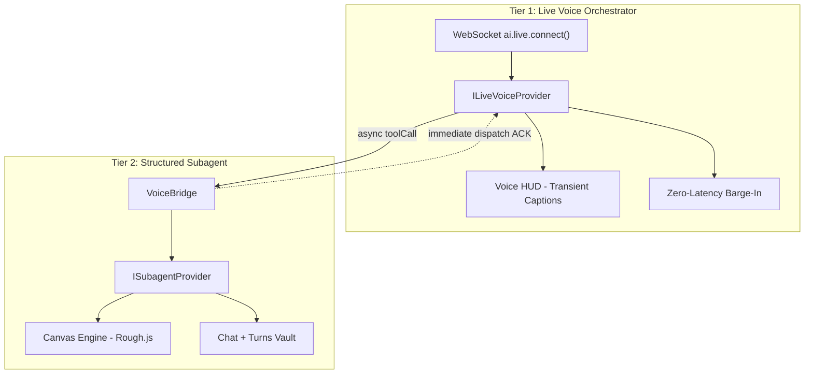
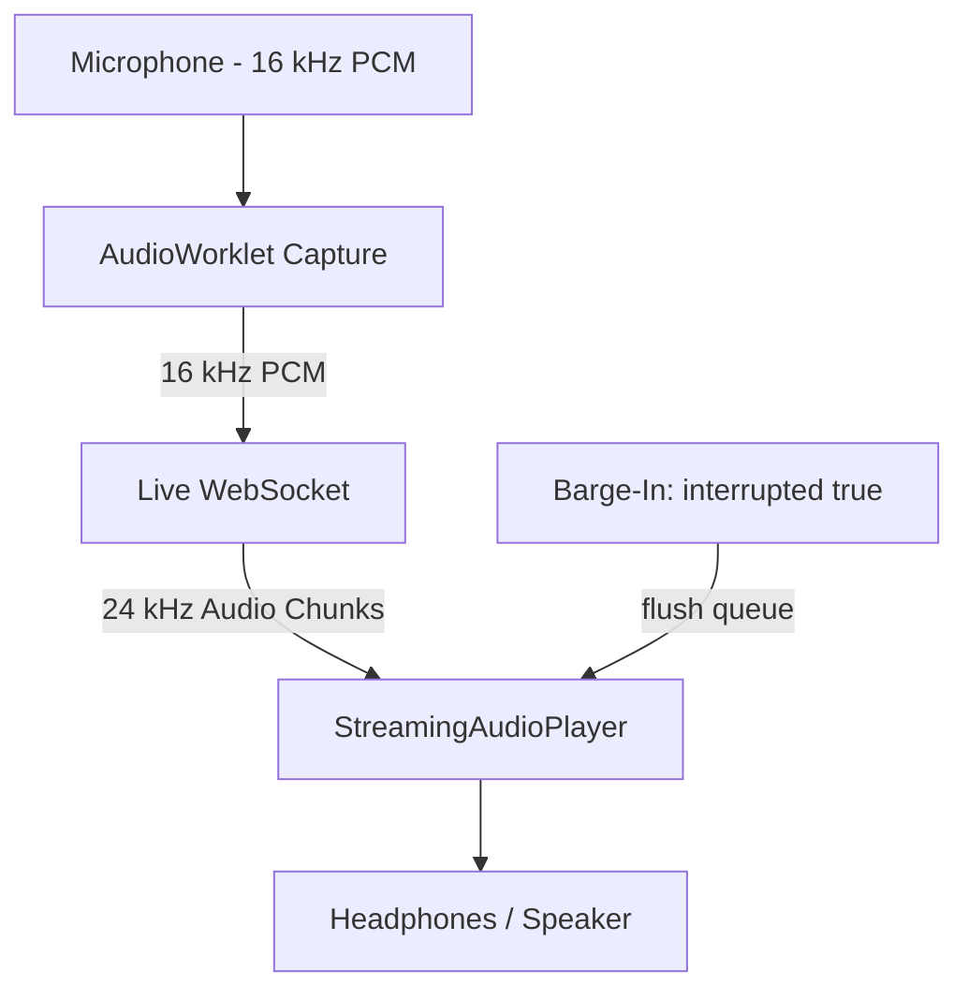

# Full-Duplex Live Voice Agent

bAssistant features a **full-duplex, bidirectional live voice mode** powered by the **Google Gemini Live API** (`@google/genai`), mid-dialogue **WebMCP tool access**, client-side **AES-GCM-256 key encryption**, and a **decoupled two-tier agent topology**.

The topology is two diagrams: the agent tiers, then the audio I/O path they share.





---

## 1. Architectural Topology: Two-Tier Agent System

Real-time audio models (`gemini-3.8-live`, `gemini-2.5-flash-native-audio-preview-12-2025`) are optimized for low-latency conversational audio, natural speech inflection, and rapid turn-taking. However, requiring native-audio models to synthesize massive JSON payloads or dense vector structures mid-speech introduces audio stutter and token bloat.

To solve this, bAssistant decouples conversational speech from heavy technical synthesis:
1. **Tier 1 (Audio Orchestrator)**: `gemini-3.8-live` handles real-time conversational banter, microphone audio streaming, and voice personality. When diagrams are requested, it invokes `generate_diagram_and_explanation` as an internal asynchronous bridge tool, immediately receiving confirmation so it can acknowledge to the user with zero awkward pause.
2. **Tier 2 (Structured Subagent)**: Runs asynchronously in the background to generate dense Canvas2D shapes and comprehensive markdown breakdowns when the user asks for diagrams, system designs, or calculations. Supports Google Gemini, OpenAI, Mistral AI, Requesty AI, and Ollama Cloud (see [Tier 2 Subagent Providers](/subagent-providers)).

---

## 2. Ephemeral Voice vs. Subagent Persistence

To maintain executive clarity in the deliberation cockpit:
- **Ephemeral Spoken Speech**: Transient conversational audio and real-time speech-to-text transcripts are displayed **only** inside the Voice HUD caption preview pill (`VoiceLiveController`). They are never saved to the chat message stream or archived in IndexedDB.
- **Subagent Knowledge Persistence**: When the Tier 2 Subagent fulfills a technical request, its markdown explanation is posted directly into the dialogue area (`ChatArea`) and saved to IndexedDB alongside full-resolution canvas snapshots.

---

## 3. Pluggable Model & Provider Interfaces

Models are completely interfaced to allow swapping between Gemini Live, OpenAI Realtime, Mistral, or local models with zero refactoring.

### Provider Contract (`src/voice/types/provider.ts`)

```typescript
export interface LiveSessionCallbacks {
  onStart?: () => void;
  onEnd?: () => void;
  onInterrupted?: () => void;
  onInputTranscription?: (text: string, isFinal: boolean) => void;
  onOutputTranscription?: (text: string) => void;
  onTurnComplete?: () => void;
  onError?: (err: unknown) => void;
  onClose?: () => void;
  onToolCall?: (name: string, args: Record<string, unknown>) => Promise<unknown>;
}

export interface ILiveVoiceSession {
  sendRealtimeAudio: (base64Pcm16: string) => void;
  close: () => void;
}

export interface ILiveVoiceProvider {
  readonly id: string;
  readonly name: string;
  connect: (config: ILiveVoiceConfig, callbacks: LiveSessionCallbacks) => Promise<ILiveVoiceSession>;
}

export interface ISubagentProvider {
  readonly id: string;
  readonly name: string;
  generateText: (prompt: string, systemInstruction?: string) => Promise<string>;
}
```

Providers push session events through `LiveSessionCallbacks`. The lifecycle-relevant ones are
`onStart` / `onEnd` (audio playback began or drained), `onInterrupted` (barge-in), `onTurnComplete`,
`onError`, and `onClose` — the last fires when the provider's own socket closes, letting the hook tear
the session down without waiting for the user.

### Configured Defaults (`src/voice/config/modelRegistry.ts`)
- **Default Live Model**: `gemini-3.8-live` (with fallback options: `gemini-2.5-flash-native-audio-preview-12-2025`, `gemini-3.1-flash-live-preview`)
- **Default Subagent Model**: `gemini-3.5-flash-lite` (with fallback option: `gemini-3.1-flash-lite`)
- **Default Studio Voice**: `Puck` (with options: `Charon`, `Kore`, `Fenrir`, `Aoede`)

---

## 4. Client-Side AES-GCM-256 Key Encryption

To prevent API keys stored in the browser from being exfiltrated via third-party scripts:
1. `cryptoStorage.ts` generates a non-extractable 256-bit AES-GCM key using `window.crypto.subtle`.
2. The master key is stored in IndexedDB (`bassistant_secure_vault` database, `bassistant_keys` store, key ID `bassistant_device_master_key_v1`).
3. User keys are encrypted with a unique 12-byte initialization vector (IV) and written to `localStorage` under `bassistant_gemini_api_key` as:
   ```
   __BASSISTANT_ENC__:v1:<base64_iv>:<base64_ciphertext>
   ```
4. Raw secret key bytes never leave the local browser environment. For the complete list of storage keys and envelope schemas, see [Storage Keys & Encrypted Vault Schema](/storage-keys).

---

## 5. Hardware Audio Engine

- **Audio Capture Worklet (`public/audio-capture-processor.js`)**: Runs on a separate audio-rendering thread to sample 16 kHz mono Int16 PCM in 2048-sample chunks (~128ms) without blocking the UI thread.
- **Streaming Audio Player (`StreamingAudioPlayer`)**: Schedules incoming 24 kHz PCM chunks against the precise `AudioContext.currentTime` clock to eliminate stutter and jitter.
- **Zero-Latency Barge-In**: When the user starts speaking while the assistant is talking, `serverContent.interrupted === true` triggers `player.interrupt()`, immediately flushing queued audio buffers.
- **Pre-flight Audio Check (`AudioPreflightModal`)**: Provides a 1-second microphone permission and volume level verification before initiating live sessions.

---

## 6. Session Lifecycle, Standby Guard & Clean Teardown

Voice state is owned by the `useVoiceAgent` hook (`src/voice/hooks/useVoiceAgent.ts`), whose `status`
takes one of the `VoiceStatus` values: `standby | connecting | listening | speaking | executing |
interrupted | error`.

- **Standby guard (`isSessionActiveRef`)**: a single ref flips to `true` the instant a connect starts
  and back to `false` in `stopListening`. Every session callback (`onStart`, `onEnd`, `onInterrupted`,
  transcriptions, `onTurnComplete`, `onToolCall`, `onError`) short-circuits when the ref is `false`, so
  late events from a socket that is already torn down can never flip the HUD back to
  `Listening`/`Speaking` after the user has stopped. `onToolCall` returns `{ error: 'Session stopped' }`
  in that state.
- **Post-connect re-checks**: after the awaited `provider.connect(...)` and again after the recorder
  starts, the hook re-reads the ref; if the session was stopped mid-connect it closes the session,
  stops the recorder, and returns without setting state.
- **Clean teardown**: `stopListening()` stops the `AudioWorkletRecorder`, closes the session, releases
  the refs, and resets `status` to `standby`. The provider's `close()` prefers the SDK `session.close()`
  and otherwise closes the underlying WebSocket with `conn.close(1000, 'Normal Closure')` — and only
  when `readyState` is `0` (CONNECTING) or `1` (OPEN). Close failures are logged, never thrown. The
  provider's socket `onclose` also fires `callbacks.onClose?.()`, so a server-side drop tears the hook
  down on its own.
- **Toggle is idempotent**: `toggleListening()` stops the session when `isListening` is true, when the
  session ref is active, or while `status === 'connecting'` — a second click during the connecting
  window cancels cleanly instead of opening a second socket.
- **Context-window compression**: the live config enables `contextWindowCompression`
  (`triggerTokens: '25600'`, `slidingWindow.targetTokens: '12800'`) so long conversations stay within
  the model's live context budget.

---

## 7. Centralized Prompts, Temporal Anchoring & WebMCP Tool Suite

All system instructions are maintained centrally in `src/voice/prompts.ts`:

### Real-Time Temporal Anchoring
Each prompt template includes the anchor:
```text
You are working as of: {current_date}.
```
Before any prompt is passed to the Gemini Live WebSocket (`gemini-3.8-live`) or the Subagent generation engine (`gemini-3.5-flash-lite`), `resolvePromptWithCurrentDate(template)` dynamically evaluates the client's current date (e.g. `2026-10-21`) and injects it into the prompt.

### Prompt Structure & Tool Catalog
To ensure both Tier 1 and Tier 2 agents operate with clean role boundaries:
- **Voice Bridge Tools (Tier 1 Live Agent Only)**:
  - `generate_diagram_and_explanation`: Asynchronous bridge tool (not a WebMCP tool) that delegates visual architecture generation to the background Subagent. Tier 1 receives immediate dispatch confirmation (~50ms) to acknowledge the user verbally while the subagent runs in the background.
  - `get_background_task_status`: Queries the status and progress of background tasks from browser cache, allowing Gemini Live to answer questions like *"Is my diagram done yet?"* verbally.
- **WebMCP Tool Catalog (Tier 1 — non-visual only)**:
  - **Retrieval & Context**: `search_web`, `search_research`, `search_document`, `get_reference_url`, `get_user_preferences`, and `clean_document`.
  - **Canvas**: `canvas2d_clear` (voice users can wipe the canvas verbally) and `canvas2d_inspect_shapes` (read-only scene graph inspection to verify node/edge counts verbally); all drawing and editing flows through the `generate_diagram_and_explanation` bridge tool.
  - **Dialogue & Reporting**: `calculate`, `export_pdf`, `chat_post`, `get_chat_history`, and `get_tool_usage_prompt`.
- **Visual Shape Tools (Tier 2 Subagent & visiting WebMCP agents only)**: `canvas2d_draw_shapes` and `canvas2d_modify_shape` are deliberately excluded from the Tier 1 declarations — the live voice model never manipulates raw shape JSON.
- The Subagent prompt is purged of `generate_diagram_and_explanation` to prevent circular bridge calls.

---

## 8. Background Task Handling

Every asynchronous dispatch is tracked by the `TaskManager` (`src/voice/tasks/taskManager.ts`) in browser `sessionStorage` (`bassistant_background_tasks`, LRU cap of 20, lifecycle `queued` -> `in_progress` -> `completed` / `failed`), with stale-task demotion on reload, serialized dispatch ordering, the `get_background_task_status` voice tool, and the reactive HUD badge. See [Background Task Handling](/background-tasks) for the full contract.

